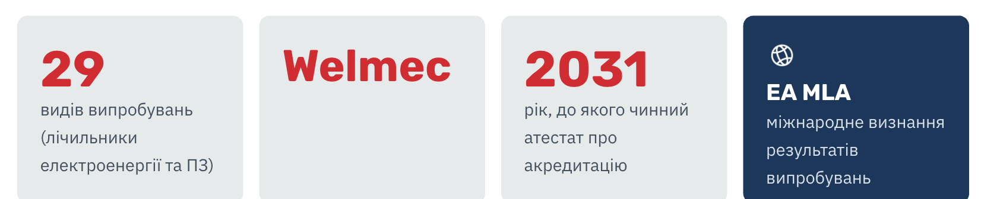
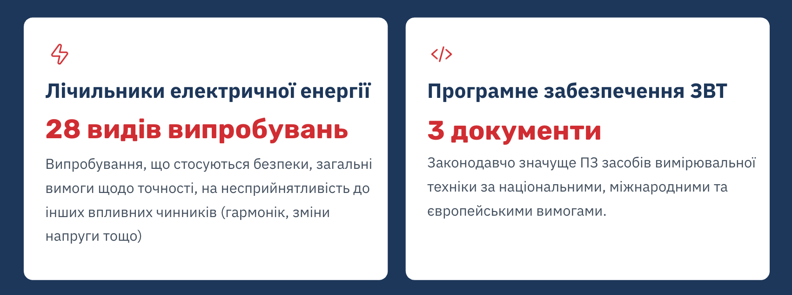
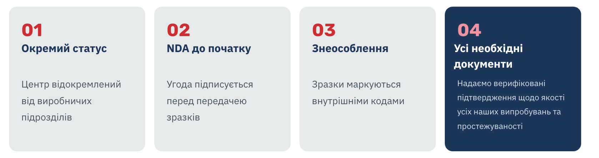
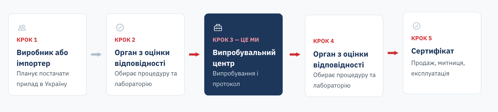
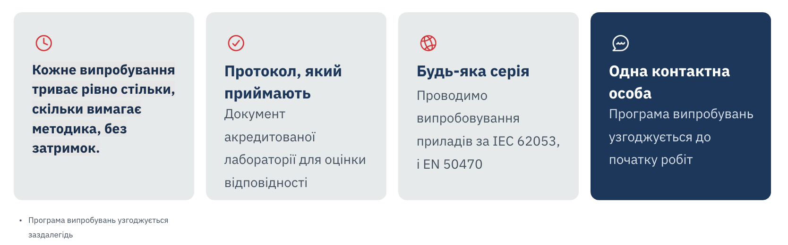

# Тексти сайту НІК-ЕЛЕКТРОНІКА (UA)

Робоча копія брифу для звірки із сайтом. Оригінал: [texts-ua.pdf](texts-ua.pdf), 68 сторінок. Якщо щось розходиться, правильним вважається PDF.

Текст нижче звіряється з PDF скриптом `node tools-for-ai/brief-check.cjs`. Правити його вручну не варто: нова версія від замовника заходить сюди, а статуси роботи ведуться окремо.

## Зміст

| Розділ | Сторінки PDF |
|---|---|
| [Головна](#головна) | 1–7 |
| [Картки товарів по категоріях](#картки-товарів-по-категоріях) | 8 |
| [Послуги](#послуги) | 8 |
| [Контрактне виробництво](#контрактне-виробництво) | 9 |
| [Високовольтні мережі](#високовольтні-мережі) | 10–11 |
| [Впровадження АСКОЕ](#впровадження-аское) | 12 |
| [Розробка на замовлення](#розробка-на-замовлення) | 13 |
| [Ремонт лічильників](#ремонт-лічильників) | 14 |
| [Програмне забезпечення](#програмне-забезпечення) | 15 |
| [Про компанію](#про-компанію) | 16–18 |
| [Історія компанії](#історія-компанії) | 19 |
| [Кар'єра](#карєра) | 20 |
| [Корпоративна культура](#корпоративна-культура) | 21–22 |
| [Вакансії](#вакансії) | 23 |
| [Студентам і випускникам](#студентам-і-випускникам) | 24 |
| [Новини](#новини) | 25 |
| [НІКіпедія](#нікіпедія) | 26 |
| [Ми у ЗМІ](#ми-у-змі) | 27 |
| [Центр оцінки відповідності](#центр-оцінки-відповідності) | 28–37 |
| [Наші партнери](#наші-партнери) | 38 |
| [Кейси та об'єкти](#кейси-та-обєкти) | 39 |
| [Сервісний центр](#сервісний-центр) | 41–42 |
| [Особистий кабінет](#особистий-кабінет) | 43–44 |
| [Особистий кабінет: робочі сторінки](#особистий-кабінет-робочі-сторінки) | 44–55 |
| [Електронні документи](#електронні-документи) | 56 |
| [Службові сторінки (404, пошук)](#службові-сторінки-404-пошук) | 57 |
| [Чат-бот: FAQ і службові фрази](#чат-бот-faq-і-службові-фрази) | 58–60 |
| [Політика cookie](#політика-cookie) | 61–62 |
| [Політика конфіденційності](#політика-конфіденційності) | 63–66 |
| [Згода на обробку персональних даних](#згода-на-обробку-персональних-даних) | 67–68 |

<!-- brief-start -->

## Головна
<!-- pdf: 1-7 -->

### SEO

| Елемент | Текст |
|---|---|
| Title (до 60 знаків) | Лічильники електроенергії, води й тепла — НІК-ЕЛЕКТРОНІКА |
| Meta description (до 160 знаків) | Український виробник систем автоматизованого обліку (AMI) лічильників електроенергії, води й тепла. Повний цикл виробництва з 2005 року. |

### 1. Хедер

| Елемент | Текст |
|---|---|
| Меню | Каталог |
| Меню | Про нас |
| Меню | Контакти |
| Меню | Прес-центр |
| Кнопка | Електронні документи |
| Підказка до іконки кабінету | Увійти в особистий кабінет |
| Плейсхолдер пошуку | Пошук моделі, документа або статті |
| Пошук без результатів | За вашим запитом нічого не знайдено. Перевірте написання або перегляньте каталог. |
| Перемикач мов | UA / EN / RU |
| Alt логотипу | НІК-ЕЛЕКТРОНІКА — на головну |

Випадні списки меню («Електронні документи» та кабінет — без випадного списку):

| Кнопка | Пункти |
|---|---|
| Каталог | Продукти · Послуги · Програмне забезпечення · Таблиця взаємозамінності · Порівняти товари |
| Про нас | Про компанію · Історія компанії · Кар'єра · Центр оцінки відповідності · Наші партнери |
| Контакти | Де купити · Сервісний центр |
| Прес-центр | Новини · НІКіпедія · Ми у ЗМІ |

### 2. HERO-блок

За вайрфреймом поверх фото — лише H1 та короткий опис, без кнопок.

| Елемент | Текст |
|---|---|
| H1 (погоджено) | Точний облік енергоресурсів — від розробки до сервісу |
| Опис під H1 | Розробляємо та виробляємо лічильники електроенергії, води й тепла та системи автоматизованого обліку (AMI) з 2005 року. Увесь цикл — від конструкторського бюро до сервісного центру — під нашим контролем. |

Слайди каруселі. Перший слайд — H1 і опис вище. На решті — заголовок і короткий опис поверх фото, без кнопок; заголовки цих слайдів оформлюємо як H2, бо H1 на сторінці один.

| Слайд | Текст |
|---|---|
| 2. Заголовок | Повний цикл виробництва |
| 2. Опис | Власне конструкторське бюро, SMT-лінія, лиття корпусів, складання, повірка, випробування та сервіс. |
| 3. Заголовок | Акредитований випробувальний центр |
| 3. Опис | Акредитація НААУ за ДСТУ EN ISO/IEC 17025:2019: 28 видів випробувань лічильників і випробування ПЗ. Результати визнані в Україні та на міжнародному рівні. |
| 4. Заголовок | Від України до ЄС та Азії |
| 4. Опис | Лічильники NIK працюють у мережах операторів систем розподілу по всій Україні, а також у країнах ЄС, Близького Сходу та Азії. |

### 3. Каталог

H2: Каталог.. Описи нижче на плитці не показуються — їх використовуємо як alt-тексти зображень і для SEO сторінок категорій.

| Категорія | Опис (alt / SEO) |
|---|---|
| Облік електроенергії | Однофазні та трифазні смарт-лічильники електроенергії |
| Облік тепла та води | Лічильники тепла та води ультразвукові та механічні |
| Компоненти АСКОЕ | Обладнання для дистанційного збору даних |
| Аксесуари | Комплектуючі та додаткове обладнання |
| Програмне забезпечення | ПЗ для дистанційного збору та обробки даних |
| Контрактне виробництво | SMT-монтаж, лиття корпусів, складання |
| Високовольтні мережі | Обладнання 0,4–35 кВ і реконструкція підстанцій |
| Мережеве обладнання | Роутери та мережеве обладнання |
| Стабілізатори напруги | Стабілізатори для захисту обладнання від перепадів напруги |

Alt-тексти ілюстрацій — за схемою «[що на зображенні] NIK», наприклад: «Лічильник електроенергії NIK». Остаточні alt — під фінальні ілюстрації.

Стрілки слайдера: «Попередні категорії», «Наступні категорії».

### 4. Про компанію

H2: Про компанію

Текст UA:

НІК-ЕЛЕКТРОНІКА — український розробник і виробник приладів обліку енергоресурсів і систем автоматизованого обліку (AMI). Працюємо з 2005 року. Ми виробляємо лічильники електроенергії, води, тепла, стабілізатори напруги та програмне забезпечення для дистанційного збору даних. Лічильники NIK використовують оператори систем розподілу по всій Україні. Продукцію експортуємо до країн ЄС, Близького Сходу та Азії.

Кнопка: Дізнатися більше

Alt-тексти для 5 фото галереї (пропозиція тем; підлаштувати під реальні фото):

| Фото | Текст |
|---|---|
| 1 | Конструкторське бюро НІК-ЕЛЕКТРОНІКА |
| 2 | SMT-лінія монтажу друкованих плат |
| 3 | Складання лічильників на виробництві |
| 4 | Випробувальний центр НІК-ЕЛЕКТРОНІКА |
| 5 | Команда НІК-ЕЛЕКТРОНІКА |

### 5. Ключові цифри

H2: Ключові цифри

| Цифра | Підпис |
|---|---|
| 150 000 | приладів на місяць |
| 10 млн+ | виготовлених приладів |
| 580+ | договорів через Prozorro |
| 20+ | років на ринку |
| 600+ | фахівців у команді |

### 6–8. Відео, клієнти та партнери, новини

| Блок | Елемент | Текст |
|---|---|---|
| 6. Відео | H2 | Відео про компанію |
| 6. Відео | Лід | Опційно: хто ми, що виробляємо і як працюємо — коротко про НІК-ЕЛЕКТРОНІКА. |
| 6. Відео | Назва для плеєра | Відео про компанію НІК-ЕЛЕКТРОНІКА |
| 7. Партнери | H2 | Клієнти та партнери |
| 7. Партнери | Лід | Оператори систем розподілу, державні й муніципальні установи, девелопери та B2B-партнери в Україні й за кордоном. |
| 7. Партнери | Alt логотипу | [Назва компанії] |
| 8. Новини | H2 | Новини та статті |
| 8. Новини | Посилання на картці | Читати далі |
| 8. Новини | Кнопка | Перейти до прес-центру |

### 9. CTA і форма зв'язку

Кнопка CTA-блоку: Зв'язатися з нами — відкриває єдину форму зворотного зв'язку. Нижче — тексти цієї форми.

| Елемент | Текст |
|---|---|
| H2 | Напишіть нам |
| Текст | Оберіть тему звернення та коротко опишіть запит. Ми передамо його профільному фахівцю і відповімо протягом 1 робочого дня. |
| Попередження (виділити кольором) | Ми працюємо з компаніями та організаціями. Якщо ви побутовий споживач, зверніться до дилера у вашому регіоні — [Де купити] — або знайдіть відповідь на своє питання в чат-боті. |
| Поле | ПІБ\* |
| Поле | Телефон\* |
| Поле | Електронна пошта\* |
| Поле (список) | Регіон\*: 24 області, м. Київ, «Інша країна» |
| Плейсхолдер регіону | Оберіть регіон |
| Поле (список) | Тема звернення\*: Сервіс / Хочу стати дистриб'ютором / Замовити прорахунок високовольтних мереж / Технічна підтримка / Замовити випробування / Маркетингові запити |
| Плейсхолдер теми | Оберіть тему |
| Поле | Короткий опис запиту\* |
| Плейсхолдер опису | Кілька речень про вашу задачу |
| Капча\* | стандартний віджет, без тексту |
| Згода\* (чекбокс) | Я погоджуюся на обробку моїх персональних даних відповідно до [Політики конфіденційності]. |
| Кнопка | Надіслати запит |
| Успіх | Дякуємо. Ми отримали ваш запит і зв'яжемося з вами протягом 1 робочого дня. |
| Помилка: порожнє поле | Заповніть це поле |
| Помилка: email | Вкажіть коректну email-адресу |
| Помилка: телефон | Вкажіть коректний номер телефону |
| Помилка: капча | Підтвердіть, що ви не робот |
| Помилка: згода | Щоб надіслати форму, підтвердіть згоду на обробку персональних даних. |
| Помилка надсилання | Не вдалося надіслати запит. Спробуйте ще раз або зателефонуйте нам: +380 (44) 498-06-19. |

Куди надходять заявки (для розробника):

- Сервіс — на email сервісного центру [надасте]
- Хочу стати дистриб'ютором — Анна Божко, відповідальний менеджер [email]
- Замовити прорахунок високовольтних мереж — відповідальний менеджер напряму [email]
- Технічна підтримка — [уточнити]
- Маркетингові запити — smm.nikel2@gmail.com
- Замовити випробування — svitlana.patalakh@nikel.com.ua (Світлана Паталах, начальниця випробувального центру)

Кнопки на інших сторінках відкривають цю ж форму з уже вибраною темою: «Замовити прорахунок» (Високовольтні мережі), «Стати партнером» (Наші партнери) → «Хочу стати дистриб'ютором», сервісні сторінки → «Сервіс», «Замовити випробування» (Центр оцінки відповідності) → «Замовити випробування». АР Крим і м. Севастополь є в списку регіонів з позначкою «тимчасово не працюємо» (краще неактивними пунктами).

### 10. Футер і cookie-банер

| Елемент | Текст |
|---|---|
| Колонка | Контакти |
| Контакти | Тел./факс: +380 (44) 498-06-19 · info@nikel.com.ua · Пн–Пт, 8:00–17:00 |
| Колонка | Ми в соцмережах |
| Соцмережі | [LinkedIn](https://www.linkedin.com/company/nik-el-ua/) · [Instagram](https://www.instagram.com/nik.elektronika) · [Facebook](https://www.facebook.com/nik.elektronika.ua) · [YouTube](https://www.youtube.com/@nik-elektronika) |
| Колонка | Юридична інформація |
| Посилання | Політика конфіденційності |
| Посилання | Політика використання файлів cookie |
| Посилання | Згода на обробку персональних даних |
| Посилання | Налаштування cookie |
| Колонка | Навігація |
| Посилання на форму | Зв'язатися з нами |
| Копірайт | © 2005–2026 ТОВ «НІК-ЕЛЕКТРОНІКА». Усі права захищено. |
| Cookie: текст | Ми використовуємо необхідні cookie, щоб сайт працював. За вашою згодою також використаємо аналітичні cookie і сторонні сервіси — карти та відео. Детальніше — у [Політиці cookie]. |
| Cookie: кнопки | Прийняти всі · Лише необхідні · Налаштувати (повні тексти банера — у вкладці «Політика cookie») |

## Картки товарів по категоріях
<!-- pdf: 8 -->

https://docs.google.com/spreadsheets/d/17Ou2SurnuoZrcnzmZR2xWJyjVZ8Jpjxod67_qQIYI0M/edit

## Послуги
<!-- pdf: 8 -->

### SEO

| Елемент | Текст |
|---|---|
| Title | Послуги НІК-ЕЛЕКТРОНІКА: виробництво, випробування, сервіс |
| Meta description | Контрактне виробництво, акредитовані випробування, обладнання 0,4–35 кВ, впровадження АСКОЕ, розробка на замовлення та ремонт лічильників. |

**H1:** Послуги

Власні конструкторське бюро, виробництво та випробувальний центр дозволяють нам не лише випускати прилади обліку, а й виконувати замовлення партнерів: від монтажу друкованих плат до здачі об'єктів енергетики «під ключ».

**Плитки** (назва + одне речення + кнопка «Детальніше»):

| Послуга | Текст |
|---|---|
| Контрактне виробництво | SMT-монтаж друкованих плат, лиття пластику та збирання пристроїв за вашою документацією. |
| Випробувальний центр | Випробування лічильників електроенергії та ПЗ засобів вимірювання в акредитованій лабораторії. |
| Високовольтні мережі | Реконструкція підстанцій «під ключ» з розподільчим обладнанням 0,4–35 кВ. |
| Впровадження АСКОЕ | Аудит, проєктування, монтаж і супровід систем автоматизованого обліку. Надає офіційний дистриб'ютор ТОВ «НІК». |
| Розробка на замовлення | Лічильники й пристрої, адаптовані під вимоги вашого ринку чи проєкту. |
| Ремонт лічильників | Діагностика, ремонт і сервісне обслуговування лічильників у нашому сервісному центрі. |

**Заклик внизу:** Опишіть свій проєкт — ми запропонуємо рішення.

**Кнопка:** Зв'язатися з нами

## Контрактне виробництво
<!-- pdf: 9 -->

### SEO

| Елемент | Текст |
|---|---|
| Title | Контрактне виробництво електроніки — НІК-ЕЛЕКТРОНІКА |
| Meta description | SMT- та DIP-монтаж друкованих плат, лиття пластику на ARBURG, розробка й збирання пристроїв. Понад 20 років досвіду виробництва електроніки в Україні. |

**H1:** Контрактне виробництво електроніки

Понад 20 років ми розробляємо й виробляємо лічильники, комунікаційні модулі, трансформатори струму та супутнє обладнання. Ті самі лінії, інженери й система контролю якості працюють і на ваші замовлення — від монтажу плат до готового пристрою.

**Переваги (3 плитки):** 20+ років розробки та виробництва · Гнучкість та оперативність · Відповідність стандартам

### Послуги та можливості

- **Монтаж друкованих плат.** Високоточний SMT-монтаж на автоматизованих лініях. Контроль якості — системи 3D SPI та AOI, надійне ESD-пакування.
- **Контрактне виробництво.** Повний цикл SMD- та DIP-монтажу з сертифікованих матеріалів на сучасному обладнанні. Швидко збираємо навіть складні пристрої.
- **Виготовлення виробів із пластику.** Власне виробництво на термопластавтоматах ARBURG: від розробки дизайну до лиття деталей із термопластів та еластомерів за індивідуальними формами.
- **Розробка пристроїв і R&D.** Проєктування, оптимізація та підготовка нових продуктів до виробництва.
- **Проєктування нестандартного обладнання.** Розробка й впровадження засобів автоматизації, зокрема тамподрукарських машин і роботизованих маніпуляторів.
- **Сервісна підтримка.** Післяпродажне обслуговування та технічний супровід.

### Потужності в цифрах

- до 150 000 приладів на місяць
- до 100 000 SMD-компонентів за годину
- рівень браку менше 1%

### Контроль якості

Кожна партія проходить розмірний контроль, механічні випробування, перевірку герметичності, функціональні та ресурсні випробування, а також вибіркову перевірку готової продукції.

**Система управління якістю сертифікована за ISO 9001.**

**Заклик:** Ми націлені на довгострокове партнерство та успіх вашого бізнесу. Зв'яжіться з нами, щоб обговорити спільний проєкт.

**Кнопка:** Обговорити проєкт

## Високовольтні мережі
<!-- pdf: 10-11 -->

### SEO

| Елемент | Текст |
|---|---|
| Title | Обладнання 0,4–35 кВ і реконструкція підстанцій — НІК-ЕЛЕКТРОНІКА |
| Meta description | ГРЩ, ВРП, АВР, КСО, КРУ, КТП і шафи РЗА власного виробництва. Проєктування, збирання та ретрофіт підстанцій 0,4–35 кВ під ключ. |

**H1:** Обладнання та реконструкція електромереж 0,4–35 кВ

Енергетичний інжиніринг повного циклу: від інтелектуального обліку до безпечного розподілу та резерву. Беремо на себе проєктування, виробництво металоконструкцій і ошиновки, збирання та здачу об'єктів «під ключ» для класів напруги від 0,4 до 35 кВ і вище. У шафах і підстанціях встановлено лічильники NIK власного виробництва.

### Низька напруга: силовий розподіл 0,4 кВ

- **ГРЩ — головні розподільчі щити.** Проєктуємо та збираємо щити на струми до 4000 А. Завдяки власному цеху обробки міді та алюмінію ошиновка витримує високі струми короткого замикання.
- **ВРП — вступно-розподільчі пристрої.** Надійні комутаційні апарати та інтелектуальні прилади обліку власного виробництва в одному корпусі. Адаптовані під вимоги операторів систем розподілу, що пришвидшує здачу об'єкта в експлуатацію.
- **АВР — автоматичне введення резерву.** Реагує на просідання або зникнення напруги за час до 0,1 с. Інтегруємо логіку керування генераторами та системами накопичення енергії прямо в силовий контур.
- **ЩО-90 — панелі розподілу.** Для комплектування РУ-0,4 кВ у міських і промислових ТП. Жорстка зварна конструкція, продумана ошиновка та зручний доступ для обслуговування. Швидко адаптуємо під типові та нестандартні схеми.

### Середня напруга: комплектні розподільчі пристрої 6–10–35 кВ

- **КСО — камери збірні одностороннього обслуговування.** Для швидкого монтажу в обмежених просторах блочних підстанцій. Жорсткі корпуси власного виробництва не деформуються під час транспортування.
- **КРУ — комплектні розподільчі пристрої.** Кожна комірка розділена на ізольовані металеві відсіки (кабельний, релейний, шинний, викотний), що локалізує будь-яку внутрішню аварію. Рішення для підприємств, де безперервність технологічного процесу критична.
- **КТП — комплектні трансформаторні підстанції.** Проєктуємо та поставляємо КТП у металевому корпусі. Ви отримуєте протестований на заводі вузол з комерційним обліком на лічильниках NIK.
- **ШРЗА — шафи релейного захисту та автоматики.** Захист ліній, трансформаторів і двигунів на базі мікропроцесорних терміналів. Робимо енергію видимою, керованою та прогнозованою.

### Ретрофіт: друге життя підстанції

Не обов'язково витрачати великий бюджет на повну заміну застарілої підстанції. Пропонуємо комплексний ретрофіт:

- заміна небезпечних масляних вимикачів на сучасні вакуумні за допомогою адаптивних монтажних комплектів;
- модернізація релейних відсіків: сучасні мікропроцесорні термінали на існуючі двері комірки;
- економічний ефект: ресурс підстанції подовжується на 25–30 років із заощадженням до 60% бюджету порівняно з будівництвом нової.

### Монтажні та проєктні організації обирають НІК-ЕЛЕКТРОНІКА

- **Конструкторське бюро.** Ми не просто збираємо за готовими специфікаціями: інженери проводять аудит проєкту, оптимізують схеми та погоджують аналоги без втрати якості.
- **Швидкість виробництва.** Власне металообробне обладнання дозволяє тримати терміни навіть у пікові періоди навантаження на ринку.
- **Гарантія та сервіс.**

**Заклик:** Надішліть однолінійну схему — ми підготуємо прорахунок проєкту.

**Кнопка:** Отримати прорахунок

## Впровадження АСКОЕ
<!-- pdf: 12 -->

### SEO

| Елемент | Текст |
|---|---|
| Title | Впровадження АСКОЕ під ключ — НІК-ЕЛЕКТРОНІКА |
| Meta description | Аудит, проєктування, монтаж і супровід систем автоматизованого обліку на базі лічильників NIK і ПЗ NovaSys. Підтримка від виробника. |

**H1:** Впровадження АСКОЕ

Передача даних між лічильниками та контролерами збору даних з NovaSys відбувається через PLC (лінії електроживлення), RF (радіоканал) або RS-485. Від контролера до сервера — мережа мобільного оператора або Ethernet.

### Що входить у послугу

1. **Аудит.** Діагностика технічного стану приладів обліку та мереж передачі даних.
2. **Проєктування.** Розробка проєкту AMI-системи під ваш об'єкт.
3. **Монтаж.** Встановлення багатотарифних лічильників і їх параметризація, налаштування передачі даних різними каналами зв'язку, переведення споживачів на тариф із диференціацією за часом доби.
4. **Сервіс.** Обслуговування чинних і нових AMI-систем, подальша підтримка сервісного центру.

### АСКОЕ NovaSys

- Понад 98% первинних даних збирається з першої спроби, 100% — з наступних ітерацій, без втрат даних
- Необмежене масштабування системи
- Сумісність зі смарт-лічильниками інших брендів
- Мобільний додаток
- Рішення «під ключ» з індивідуальним налаштуванням
- Сервісна та технічна підтримка безпосередньо від виробника

**ВАЖЛИВО**: Послугу надає офіційний дистриб'ютор NIK — ТОВ «НІК». Він проєктує, монтує та обслуговує системи автоматизованого обліку (AMI) для житлових і промислових об'єктів на базі лічильників, контролерів збору даних і програмного забезпечення NovaSys.

**Кнопка:** Зв'язатися з ТОВ «НІК» (веде на nik.net.ua; email nik@nik.net.ua)

## Розробка на замовлення
<!-- pdf: 13 -->

### SEO

| Елемент | Текст |
|---|---|
| Title | Лічильники на замовлення: розробка та виробництво — НІК |
| Meta description | Адаптуємо лічильники та пристрої під вимоги вашого ринку чи проєкту: інтерфейси, протоколи, корпус, функції. Власне конструкторське бюро та виробництво. |

**H1:** Лічильники та пристрої на замовлення

Увесь цикл проходить під нашим контролем: власне конструкторське бюро, SMT-лінія монтажу друкованих плат, лиття пластикових корпусів, складання, повірка, випробування та сервісний центр. Завдяки цьому ми швидко адаптуємо прилади під вимоги конкретного ринку чи замовника — або створюємо новий пристрій під ваше завдання.

### Що можна адаптувати

- **Зв'язок.** Інтерфейси PLC, GSM/LTE, RF, RS-485 та їх поєднання.
- **Протоколи.** Підтримка DLMS/COSEM та IDIS.
- **Функції.** Тарифи та зони, передплата, реле відключення навантаження, захист від втручань.
- **Корпус.** Власна розробка прес-форм і лиття.
- **Маркування та пакування.** Під вимоги замовника.
- **Сертифікація.** Лічильники NIK мають сертифікати CE, CCC, IDIS та DLMS. Готуємо пристрій до сертифікації на цільовому ринку.

### Як ми створюємо пристрій

1. **Аналіз вимог.** Вивчаємо задачу та готуємо технічне завдання.
2. **Електроніка.** Розробляємо плати та апаратну частину.
3. **Корпус.** Створюємо 3D-модель, прес-форму та робимо пробне лиття.
4. **Програмне забезпечення.** Тестове, виробниче та ПЗ верхнього рівня.
5. **Випробування та пробна партія.** Перевіряємо апаратну частину й функції, готуємо технічну документацію.
6. **Сертифікація.** Підтверджуємо відповідність вимогам цільового ринку.
7. **Серійне виробництво.**

**Заклик:** Опишіть задачу — наші інженери запропонують рішення під ваші вимоги.

**Кнопка:** Обговорити задачу

## Ремонт лічильників
<!-- pdf: 14 -->

### SEO

| Елемент | Текст |
|---|---|
| Title | Ремонт лічильників NIK — сервісний центр виробника |
| Meta description | Діагностика, ремонт і сервісне обслуговування лічильників у сервісному центрі виробника НІК-ЕЛЕКТРОНІКА. |

**H1:** Ремонт і сервісне обслуговування лічильників

Ремонт у виробника — це оригінальні комплектуючі, інженери, які знають прилад зсередини, і власне випробувальне обладнання. Наш сервісний центр ремонтує та проводить експертизу лічильників і обладнання NIK.

Адреси та перелік приладів — на сторінці «Сервісний центр».

### Що ми робимо

- Діагностика несправностей
- Гарантійний і післягарантійний ремонт
- Оновлення програмного забезпечення та параметризація
- Перевірка після ремонту [уточнити: чи так]

### Як здати лічильник у ремонт

1. Залиште заявку: модель, серійний номер і опис несправності.
2. Принесіть лічильник у пункт прийому або надішліть Новою поштою із супровідним листом.
3. Ми проведемо діагностику та погодимо з вами вартість і строки.
4. Після ремонту повернемо лічильник.

### Утилізація старих лічильників

Ми приймаємо застарілі або замінені моделі наших лічильників на утилізацію. Щоб підібрати заміну застарілій моделі, скористайтеся таблицею взаємозамінності.

**Кнопки:** Залишити заявку на ремонт · Таблиця взаємозамінності

## Програмне забезпечення
<!-- pdf: 15 -->

### SEO

| Елемент | Текст |
|---|---|
| Title | АСКОЕ та програмне забезпечення обліку енергоресурсів — NIK |
| Meta description | Веб-платформи та мобільні застосунки NIK для збору, обробки й аналізу даних із приладів обліку: NovaSys, NIK Space, NIK-Surfer та інші |

| Елемент | Текст |
|---|---|
| H1 | АСКОЕ та Програмне забезпечення |
| Вступ | Програмне забезпечення NIK для збору, обробки та аналізу даних із приладів обліку. Ми розробляємо його самі, тому воно повністю сумісне з лічильниками та контролерами NIK. |
| Група 1 | Веб-платформи |
| Група 2 | Мобільні застосунки |
| Кнопка на картці | Детальніше |
| Заклик внизу | Допоможемо підібрати рішення для вас |

## Про компанію
<!-- pdf: 16-18 -->

### SEO

| Елемент | Текст |
|---|---|
| Title | Про компанію — НІК-ЕЛЕКТРОНІКА, виробник лічильників та АСКОЕ |
| Meta description | Український розробник і виробник приладів обліку енергоресурсів і систем AMI з 2005 року. Повний цикл виробництва, акредитований випробувальний центр, ISO 9001. |

**H1:** Про компанію

**Вступне гасло під H1:**

**Точний облік енергії: комплексні smart-рішення для енергоменеджменту**

НІК-ЕЛЕКТРОНІКА — український розробник і виробник приладів обліку енергоресурсів і систем автоматизованого обліку (AMI). Працюємо з 2005 року.

Ми виробляємо лічильники електроенергії, води, тепла, стабілізатори напруги, програмне забезпечення для дистанційного збору даних та інші продукти для розумного і точного обліку ресурсів.

Увесь цикл проходить під нашим контролем: власне конструкторське бюро, SMT-лінія монтажу друкованих плат, лиття пластикових корпусів, складання, повірка, випробування та сервісний центр. Завдяки цьому ми можемо адаптувати прилади під вимоги конкретного ринку чи замовника.

### НІК-ЕЛЕКТРОНІКА в цифрах

- до 150 000 приладів на місяць;
- понад 10 млн виготовлених приладів;
- понад 580 виконаних договорів через Prozorro.

### Наші клієнти

Лічильники NIK використовують оператори систем розподілу по всій Україні. Серед наших клієнтів також державні й муніципальні установи, девелопери та B2B-партнери. Продукцію експортуємо до країн ЄС, Близького Сходу та Азії.

### Якість і стандарти

Прилади підтримують протоколи DLMS/COSEM та IDIS, система управління якістю сертифікована за ISO 9001.

Наш випробувальний центр акредитований Національним агентством з акредитації України на відповідність ДСТУ EN ISO/IEC 17025:2019 у сфері випробувань лічильників електричної енергії та програмного забезпечення засобів вимірювальної техніки. Це означає, що результати наших випробувань мають офіційно визнану достовірність.

### Команда

У нашій команді понад 600 людей: інженери, програмісти, конструктори, технологи, виробничі фахівці, маркетологи та інші. Деякі працівники з нами понад 10 років.

Ми цінуємо інженерну точність і відповідальність за результат, а кожен працівник бачить, які результати приносить його робота.

### Місія, бачення та цінності

| Елемент | Текст |
|---|---|
| Підзаголовок | Наша місія |
| Місія | Ми рухаємо світ енергетики вперед: знаходимо нові точні та ефективні рішення для обліку енергоресурсів, які допомагають компаніям контролювати витрати й дбайливо використовувати ресурси. |
| Підзаголовок | Наше бачення |
| Бачення | Ми бачимо майбутнє, у якому кожен ресурс облікований точно й використаний дбайливо. Нам важливо берегти ресурси планети, людей і компаній, з якими ми працюємо. Тому ми постійно розвиваємося, стежимо за прогресом і шукаємо нестандартні рішення. |
| Підзаголовок | Наші цінності |
| Цінність 1 | **Інноваційність.** Шукаємо, як зробити швидше, простіше й ефективніше, і не боїмося тестувати нові підходи. |
| Цінність 2 | **Якість.** Дотримуємося стандартів і перевіряємо кожен результат, думаючи про кінцевого користувача. |
| Цінність 3 | **Довіра.** Виконуємо обіцянки, говоримо прямо й беремо відповідальність за свій результат. |
| Цінність 4 | **Ефективність.** Фокусуємося на результаті й пропонуємо рішення, а не лише вказуємо на проблеми. |

### Кнопки внизу сторінки

| Текст |
|---|
| Історія компанії |
| Кар'єра |
| Центр оцінки відповідності |
| Кейси та об'єкти |
| Зв'язатися з нами |

## Історія компанії
<!-- pdf: 19 -->

### SEO

| Елемент | Текст |
|---|---|
| Title | Історія компанії НІК-ЕЛЕКТРОНІКА |
| Meta description | Від заснування до сьогодні: ключові етапи розвитку НІК-ЕЛЕКТРОНІКА. |

| | Текст |
|---|---|
| H1 | Історія компанії |
| Вступ | З 2005 року ми розробляємо й виробляємо прилади обліку енергоресурсів. Ось ключові етапи нашого шляху. |

### Лінія часу

| Рік | Текст |
|---|---|
| 8 квітня 2005 | **Заснування компанії.** НІК-ЕЛЕКТРОНІКА починає розробляти й виробляти прилади обліку енергоресурсів. |
| 2009 | **Розширення виробництва.** Відкриваємо нове виробництво та запускаємо нові напрямки: [уточнити, які]. |
| 2021 | **Власне виробництво плат.** Запускаємо новий завод та автоматизовану лінію SMT. |
| 2022 — дотепер | **Працюємо попри війну.** Продовжуємо виробляти прилади та розвивати smart-рішення для енергетики в умовах повномасштабної війни. |
| 30 вересня 2026 | **Незалежний випробувальний центр НІК-ЕЛЕКТРОНІКА отримує акредитацію** відповідно до вимог ДСТУ EN ISO/IEC 17025:2019 (EN ISO/IEC 17025:2017, IDT; ISO/IEC 17025:2017, IDT) у сфері випробування лічильників електричної енергії та програмного забезпечення засобів вимірювальної техніки. |
| Сьогодні | **Понад 600 людей у команді.** Понад 10 млн виготовлених приладів і експорт до країн ЄС, Близького Сходу та Азії. |

**Кнопки внизу:** Про компанію · Кар'єра

## Кар'єра
<!-- pdf: 20 -->

### SEO

| Елемент | Текст |
|---|---|
| Title | Кар'єра в НІК-ЕЛЕКТРОНІКА — вакансії та практика |
| Meta description | Вакансії, практика для студентів і корпоративна культура НІК-ЕЛЕКТРОНІКА. Долучайтеся до команди, що створює прилади обліку енергоресурсів і друковані плати. |

**H1:** Кар'єра в НІК-ЕЛЕКТРОНІКА

Понад 600 людей щодня створюють прилади обліку, які працюють в Україні та за кордоном. У нас кожен бачить реальний результат своєї роботи: на рахунку команди вже понад 10 млн виготовлених приладів.

### Чому НІК-ЕЛЕКТРОНІКА (4 плитки з іконками)

- Провідний виробник систем енергоменеджменту
- Проєкти для ринків ЄС, Близького Сходу та Азії
- Власне конструкторське бюро й повний цикл виробництва
- Постійне впровадження нових технологій

### Ми пропонуємо

- Цікаві та нестандартні завдання, від яких залежить реальний продукт
- Професійне зростання разом із компанією, яка постійно розвивається
- Спеціалізоване навчання й підвищення кваліфікації
- Участь у впровадженні новітніх технологій і формуванні нової культури споживання ресурсів в Україні

### Кого ми шукаємо

Нам близькі люди, які беруть відповідальність на себе, не бояться ставити запитання, проявляють ініціативу, тримають слово й орієнтуються на результат. Якщо це про вас, будемо раді знайомству.

### Розділи (плитки-переходи)

- **Корпоративна культура.** Як ми працюємо і що для нас важливо.
- **Вакансії.** Актуальні відкриті позиції в команді.
- **Студентам і випускникам.** Практика і перші кроки в професії.

### Заклик внизу

Долучайтеся до команди НІК-ЕЛЕКТРОНІКА. Надішліть резюме, і ми зв'яжемося з вами, щойно з'явиться відповідна позиція.

**Кнопка**: Надіслати резюме (nikel_kiev_rec_list@nikel.com.ua — налаштовується в адмінці)

## Корпоративна культура
<!-- pdf: 21-22 -->

### SEO

| Елемент | Текст |
|---|---|
| Title | Корпоративна культура — НІК-ЕЛЕКТРОНІКА |
| Meta description | Інноваційність, якість, довіра та ефективність: як працює команда з понад 600 людей, що створює прилади обліку енергоресурсів. |

**H1:** Корпоративна культура

У нашій команді понад 600 людей: інженери, програмісти, конструктори, технологи, виробничі фахівці, маркетологи та інші. Деякі працівники з нами понад 10 років.

Ми цінуємо інженерну точність і відповідальність за результат, а кожен працівник бачить, які результати приносить його робота.

### Як ми на практиці реалізуємо наші цінності

#### Інноваційність

- Пропонуємо покращення, навіть якщо це не входить у наші задачі
- Шукаємо, як зробити швидше, простіше й дешевше
- Не боїмося тестувати нові підходи

#### Якість

- Перевіряємо свою роботу, перш ніж передати її далі
- Дотримуємося стандартів і не «спрощуємо», якщо це шкодить результату
- Думаємо про кінцевого користувача та клієнта

#### Довіра

- Виконуємо обіцянки або заздалегідь попереджаємо про ризики
- Говоримо прямо, не приховуючи проблем
- Беремо відповідальність за свій результат

#### Ефективність

- Фокусуємося на результаті, а не на процесі
- Вміємо розставляти пріоритети
- Пропонуємо рішення, а не лише вказуємо на проблеми

### Хто досягає успіху в NIK

Люди, які:

- швидко беруть відповідальність;
- не бояться ставити питання;
- орієнтуються на результат, а не на процес;
- дотримуються домовленостей;
- проявляють ініціативу;
- поділяють цінності компанії.

### Фото команди

Галерея з фото робочих буднів і команди. Alt-тексти — під фінальні фото.

**Кнопка:** Відкриті вакансії

## Вакансії
<!-- pdf: 23 -->

### SEO

| Елемент | Текст |
|---|---|
| Title | Вакансії НІК-ЕЛЕКТРОНІКА — робота в енергетиці |
| Meta description | Відкриті вакансії для інженерів, програмістів, технологів і виробничих фахівців у компанії, що виробляє прилади обліку енергоресурсів. |

| Елемент | Текст |
|---|---|
| H1 | Вакансії |
| Вступ | Приєднуйтеся до команди з понад 600 людей, яка створює прилади обліку для України та інших країн. Оберіть вакансію та надішліть нам резюме. |
| Поля картки | Посада · Відділ · Локація |
| Кнопка | Відгукнутися |
| Немає вакансій | Зараз відкритих вакансій немає. Надішліть резюме — ми зв'яжемося, щойно з'явиться позиція для вас. |
| Кнопка (немає вакансій) | Надіслати резюме |
| Тема листа mailto | Відгук на вакансію: [назва посади] |

## Студентам і випускникам
<!-- pdf: 24 -->

### SEO

| Елемент | Текст |
|---|---|
| Title | Практика для студентів — НІК-ЕЛЕКТРОНІКА |
| Meta description | Практика для студентів і випускників технічних спеціальностей на виробництві приладів обліку. Реальні задачі, наставник і старт кар'єри в енергетиці. |

**H1:** Студентам і випускникам

Почніть кар'єру в НІК-ЕЛЕКТРОНІКА. Ви на практиці дізнаєтесь, як прилад проходить шлях від креслення до серійного виробництва, і самі долучитеся до цієї роботи.

### Для кого практика

Для студентів старших курсів і випускників технічних спеціальностей: електроніки, приладобудування, електротехніки, метрології, програмування та автоматизації.

### Де можна пройти практику

- **Конструкторське бюро та R&D.** Розробка електроніки й конструкції нових приладів.
- **Програмне забезпечення.** Вбудоване ПЗ лічильників і системи дистанційного збору даних.
- **Виробництво.** SMT-монтаж друкованих плат, складання та технології виробництва.
- **Випробування та повірка.** Робота в акредитованому випробувальному центрі.

### Що ви отримаєте

- Реальні задачі замість навчальних вправ
- Наставника, який допоможе розібратися в процесах
- Досвід роботи з сучасним обладнанням і стандартами галузі
- Допомогу з оформленням документів для навчальної практики
- Можливість претендувати на вакансії компанії після практики

### Як потрапити на практику

1. Надішліть резюме та вкажіть, який напрям вас цікавить.
2. Пройдіть співбесіду з HR і керівником відділу.
3. Разом узгодимо терміни й план практики.

**Кнопка:** Подати заявку на практику

## Новини
<!-- pdf: 25 -->

### SEO

| Елемент | Текст |
|---|---|
| Title сторінки | Новини НІК-ЕЛЕКТРОНІКА |
| Meta description | Новини виробника приладів обліку енергоресурсів: нові продукти, сертифікація, виробництво, виставки та проєкти. |
| Title новини | [Заголовок новини] — НІК-ЕЛЕКТРОНІКА |
| Meta description новини | Береться з ліду (перші 1–2 речення) |

| Елемент | Текст |
|---|---|
| H1 | Новини |
| Вступ | Нові продукти, сертифікація, розвиток виробництва, виставки та проєкти НІК-ЕЛЕКТРОНІКА. |
| Посилання на картці | Читати далі |
| Кнопка внизу стрічки | Показати ще |
| Порожній стан | Новин поки немає. |
| На сторінці новини | ← Усі новини · Поділитися · Інші новини |

## НІКіпедія
<!-- pdf: 26 -->

### SEO

| Елемент | Текст |
|---|---|
| Title сторінки | НІКіпедія — технічна енциклопедія про облік енергії |
| Meta description | Статті про лічильники електроенергії, води й тепла, системи АСКОЕ, протоколи передачі даних і сертифікацію. Від інженерів NIK. |
| Title статті | [Тема статті] — НІКіпедія |
| Meta description статті | Коротка відповідь з початку статті |

| Елемент | Текст |
|---|---|
| H1 | НІКіпедія |
| Вступ | Технічна енциклопедія NIK про облік енергоресурсів. Пояснюємо, як працюють лічильники та системи АСКОЕ, як передаються дані та що означає сертифікація. |
| Теми (фільтр) | Усі статті · Сертифікації · Лічильники · Принципи роботи · Передача даних |
| Пошук | Пошук статей |
| На картці | Читати статтю · Час читання: N хв |
| На сторінці статті | Оновлено: [дата] · Автор: [ім'я, посада] · Пов'язані продукти NIK · Читайте також |
| Нічого не знайдено | Статей за цим запитом немає. Спробуйте інше слово або поставте питання в чаті. |

## Ми у ЗМІ
<!-- pdf: 27 -->

### SEO

| Елемент | Текст |
|---|---|
| Title | НІК-ЕЛЕКТРОНІКА у ЗМІ — публікації та згадки |
| Meta description | Публікації, інтерв'ю та згадки про НІК-ЕЛЕКТРОНІКА в медіа та на галузевих ресурсах. |

| Елемент | Текст |
|---|---|
| H1 | Ми у ЗМІ |
| Вступ | Публікації та згадки про НІК-ЕЛЕКТРОНІКА в медіа й на галузевих ресурсах. |
| Поля картки | Видання · Дата · Заголовок · Опис |
| Кнопка на картці | Читати на сайті видання (відкривається в новій вкладці) |
| Порожній стан | Публікацій поки немає. |
| Блок для журналістів (опційно) | Для журналістів: запити на коментарі та інтерв'ю надсилайте на smm.nikel2@gmail.com. |

## Центр оцінки відповідності
<!-- pdf: 28-37 -->

### SEO

| Елемент | Текст |
|---|---|
| Title | Центр оцінки відповідності та випробування лічильників — НІК |
| Meta description | Акредитований НААУ випробувальний центр НІК-ЕЛЕКТРОНІКА: 28 видів випробувань лічильників електроенергії та випробування ПЗ ЗВТ. Атестат чинний до 2031 року. |

**H1:** Центр оцінки відповідності

### Випробувальний центр

Наш **випробувальний центр акредитований Національним агентством з акредитації України на відповідність ДСТУ EN ISO/IEC 17025:2019** у сфері випробувань лічильників електричної енергії та програмного забезпечення засобів вимірювальної техніки.

Це означає, що результати наших випробувань мають **офіційно визнану достовірність.**

Ми випробовуємо не лише власну продукцію. До нас звертаються виробники, імпортери й дистриб'ютори лічильників, органи з оцінки відповідності та розробники програмного забезпечення для засобів вимірювальної техніки.

### Центр у цифрах (4 плитки)

- **28** видів випробувань лічильників у сфері акредитації
- **3** нормативні документи для випробувань ПЗ
- **2031** — рік, до якого чинний атестат про акредитацію
- **EA MLA** — міжнародне визнання результатів випробувань

### Атестат про акредитацію

| Параметр | Значення |
|---|---|
| Орган з акредитації | Національне агентство з акредитації України (НААУ) |
| Стандарт | ДСТУ EN ISO/IEC 17025:2019 |
| Номер атестата | 202502 |
| Дата реєстрації | 30 вересня 2026 року |
| Чинний до | 29 вересня 2031 року |
| Сфера | Лічильники електричної енергії та програмне забезпечення засобів вимірювальної техніки |
| Додаток | Сфера акредитації на 19 аркушах |

НААУ — підписант Угоди EA MLA та Угоди Global ACI MRA у сфері «Випробування». Тому наші протоколи видаються в системі акредитації, визнаній на європейському та міжнародному рівнях.

Чинність атестата можна перевірити у відкритому реєстрі НААУ [посилання на запис у реєстрі].

### Навіщо лічильнику випробування

Лічильники активної електричної енергії — законодавчо регульовані засоби вимірювальної техніки: категорія MI-003 Технічного регламенту засобів вимірювальної техніки, затвердженого постановою КМУ від 24.02.2016 № 163.

Без оцінки відповідності лічильник не можна розмитнити, продати та ввести в експлуатацію. А для сертифіката потрібен протокол акредитованої лабораторії.

1. **Виробник або імпортер** планує постачати прилад в Україну.
2. **Орган з оцінки відповідності** обирає процедуру та лабораторію.
3. **Наш випробувальний центр** проводить випробування і видає протокол.
4. **Сертифікат.** Прилад можна розмитнити, продавати й експлуатувати.

### Що ми випробовуємо

**Лічильники електричної енергії — 28 видів випробувань.** Метрологічна точність, вплив гармонік і аномалій мережі, кліматичні та навантажувальні випробування, довговічність, безпека, маркування.

**Програмне забезпечення засобів вимірювальної техніки.** Законодавчо значуще ПЗ — за національними, міжнародними та європейськими вимогами.

### Випробування лічильників

#### Метрологічна точність

| № | Випробування | Що підтверджує |
|---|---|---|
| 1.4 | Передатне число (стала) | Імпульсний вихід відповідає сталій |
| 1.5 | Початковий запуск | Прилад стартує за нормований час |
| 1.6 | Відсутність самоходу | Без навантаження енергія не накручується |
| 1.7 | Поріг чутливості | Облік при мінімальному струмі |
| 1.8 | Збіжність | Повторюваність результатів |
| 1.9 | Межі похибки за струмом | Клас точності в робочому діапазоні |
| 1.10 | Точність відліку часу | Годинник для багатозонного обліку |

#### Точність у реальній мережі

**Спотворення форми кривої:**

- 1.11 Гармоніки в колах струму та напруги
- 1.12 Інтергармоніки в колі струму
- 1.13 Непарні гармоніки в колі струму
- 1.14 Постійний струм і парні гармоніки

Зокрема, перевіряємо стійкість до типових схем спотворення обліку випрямленим сигналом.

**Аномалії мережі та зовнішні впливи:**

- 1.15 Зміна напруги
- 1.16 Зміна температури середовища
- 1.17 Переривання фазної напруги
- 1.18 Зміна частоти
- 1.19 Зворотна послідовність фаз
- 1.20 Зміна допоміжної напруги
- 1.21 Робота допоміжних пристроїв
- 1.24 Швидкі зміни струму навантаження
- 1.25 Замикання на землю

#### Надійність в експлуатації

- 1.22 Короткочасні перевантаження струмом
- 1.23 Самонагрівання
- 1.26 Випробування на сухе тепло
- 1.27 Випробування на холод
- 1.28 Випробування на довговічність

Довговічність — за ДСТУ EN 62059-32-1:2016.

#### Безпека, споживання, маркування

- 1.1 Випробування, що стосуються безпеки
- 1.2 Потужність власного споживання
- 1.3 Маркування лічильника

Безпека — за ДСТУ EN 62052-31:2022 та ДСТУ EN 50470-3:2022.

Нумерація — за додатком до атестата про акредитацію № 202502. Повний перелік 28 позицій надаємо за запитом.

### Випробування програмного забезпечення

Перевіряємо законодавчо значуще ПЗ:

- вимірювання та облік енергії;
- тарифікацію;
- журнал подій;
- збереження даних під час оновлення;
- розділення та захист від змін.

А також функції поза метрологією: інтерфейси зв'язку, дисплей і сервісні режими, оновлення прошивки.

Нормативні документи: ДСТУ 7363:2013 (національні вимоги), ДСТУ OIML D 31:2018 (міжнародні вимоги OIML), WELMEC 7.2:2020 (європейський документ до директиви MID).

### Нормативна база

У сфері акредитації — чинні й попередні редакції стандартів. Тож ми проводимо випробування і для нової сертифікації, і для підтримки виробів, що вже на ринку.

| Стандарт | Про що |
|---|---|
| ДСТУ EN IEC 62052-11:2024 · EN 62052-11:2015 | Загальні вимоги та умови випробувань |
| ДСТУ EN 62052-31:2022 | Вимоги безпеки та випробування на безпеку |
| ДСТУ EN IEC 62053-21 · 62053-22 | Активна енергія: класи 0,5–2 та 0,1S–0,5S |
| ДСТУ EN IEC 62053-23 · 62053-24 | Реактивна енергія, зокрема за основною гармонікою |
| ДСТУ EN 50470-3:2022 | Європейська серія: класи A, B, C |
| ДСТУ EN 62054-21:2015 | Реле часу, багатозонний облік |
| ДСТУ EN 62059-32-1:2016 | Надійність і довговічність |
| ДСТУ 7363:2013 · OIML D 31 · WELMEC 7.2:2020 | Програмне забезпечення ЗВТ |

### Для кого

#### Імпортерам і дистриб'юторам: випробування в Україні замість відправки зразків за кордон

- Коротший цикл: зразки не їдуть за кордон і не стоять у черзі закордонної лабораторії.
- Протокол акредитованої лабораторії, який приймають для оцінки відповідності.
- Будь-яка серія: приймаємо прилади і за IEC 62053, і за EN 50470.
- Одна контактна особа, програму випробувань узгоджуємо до початку робіт.

#### Органам з оцінки відповідності: лабораторія, яку можна внести до свого переліку

- Випробування лічильників за 28 позиціями та ПЗ засобів вимірювальної техніки.
- Чинні й попередні редакції стандартів, серії IEC 62053 та EN 50470 одночасно.
- Програму випробувань узгоджуємо заздалегідь, угода про конфіденційність — стандартний крок.
- Представник замовника може бути присутнім, протокол містить посилання на пункти стандартів.

Надамо повний пакет для внесення до вашого переліку лабораторій: атестат, додаток зі сферою, відомості про обладнання та персонал.

#### Виробникам лічильників: неупередженість — це процедура

Вимоги ДСТУ EN ISO/IEC 17025:2019 щодо неупередженості та конфіденційності перевіряються під час акредитаційної оцінки. На практиці це означає:

- **Окремий статус.** Центр відокремлений від виробничих підрозділів.
- **Угода про конфіденційність до початку робіт.** Підписуємо її перед передачею зразків.
- **Знеособлення.** Зразки маркуються внутрішніми кодами.
- **Ваша присутність.** Представник замовника може бути на випробуваннях.

### Як замовити випробування

1. Надішліть перелік приладів або опис програмного забезпечення.
2. Узгодимо програму випробувань, строки й вартість. За потреби підпишемо угоду про конфіденційність.
3. Проведемо випробування та видамо протокол.

За запитом надаємо копію атестата з додатком на 19 аркушах, повний перелік позицій випробувань, відомості про обладнання та комерційну пропозицію під вашу програму.

**Контактна особа:** Світлана Паталах, начальниця випробувального центру · +380 (68) 448-18-52 · svitlana.patalakh@nikel.com.ua

**Кнопка:** Замовити випробування — відкриває форму зв'язку з темою «Замовити випробування»; заявки надходять на svitlana.patalakh@nikel.com.ua.

### Часті питання

**Це повірка лічильників?** Ні. Ми проводимо випробування. Повірка приладів в експлуатації до нашої сфери акредитації не входить.

**Скільки триває випробування?** Залежить від програми. Строк називаємо після узгодження переліку позицій. [типові строки — уточнити]

**Скільки це коштує?** Вартість залежить від програми випробувань. Комерційну пропозицію готуємо на запит.

**Якою мовою протокол?** Українською.

**Чи захищена наша інформація?** Так. Конфіденційність — вимога ДСТУ EN ISO/IEC 17025:2019, угоду про конфіденційність підписуємо до передачі зразків.

**Що робити, якщо потрібне випробування поза сферою акредитації?** Ми скажемо про це прямо й підкажемо лабораторію. Поза атестатом нічого не обіцяємо.

### Сертифікати компанії

Грід карток: логотип, назва, короткий опис, PDF (опційно). Це сертифікати компанії, не продуктів.

| Сертифікат | Опис |
|---|---|
| ISO 9001:2015 | Система управління якістю |
| ISO 14001:2015 | Система екологічного управління |
| ISO/IEC 27001:2022 | Система управління інформаційною безпекою |
| ДСТУ EN ISO/IEC 17025:2019 | Акредитація випробувального центру НААУ |

### Політика щодо дитячої праці

НІК-ЕЛЕКТРОНІКА не використовує дитячу працю в жодній формі. Ми не приймаємо на роботу осіб, молодших за мінімальний вік, встановлений законодавством України, і дотримуємося принципів конвенцій Міжнародної організації праці № 138 про мінімальний вік і № 182 про найгірші форми дитячої праці.

### Додати

додати на початку заголовок

**ВИПРОБУВАЛЬНИЙ ЦЕНТР НІК-ЕЛЕКТРОНІКА**

Акредитовані випробування лічильників електричної енергії та програмного забезпечення засобів вимірювальної техніки

Випробувальний центр ТОВ «НІК-ЕЛЕКТРОНІКА» акредитований Національним агентством з акредитації України за ДСТУ EN ISO/IEC 17025:2019 на випробування лічильників електричної енергії та програмного забезпечення засобів вимірювальної техніки.

- **29** видів випробувань (лічильники електроенергії та ПЗ)
- **Welmec**
- **2031** рік, до якого чинний атестат про акредитацію
- **EA MLA** міжнародне визнання результатів випробувань

додати значок європейського визнання

**СФЕРА АКРЕДИТАЦІЇ**

#### Два напрями робіт

**Лічильники електричної енергії**

28 видів випробувань

Випробування, що стосуються безпеки, загальні вимоги щодо точності, на несприйнятливість до інших впливних чинників (гармонік, зміни напруги тощо)

**Програмне забезпечення ЗВТ**

3 документи

Законодавчо значуще ПЗ засобів вимірювальної техніки за національними, міжнародними та європейськими вимогами.

#### Неупередженість — не обіцянка, а процедура

Вимоги ДСТУ EN ISO/IEC 17025:2019 щодо неупередженості та конфіденційності є предметом акредитаційної оцінки. На практиці це означає чотири речі.

- **01 Окремий статус** Центр відокремлений від виробничих підрозділів
- **02 NDA до початку** Угода підписується перед передачею зразків
- **03 Знеособлення** Зразки маркуються внутрішніми кодами
- **04 Усі необхідні документи** Надаємо верифіковані підтвердження щодо якості усіх наших випробувань та простежуваності

#### Як лічильник потрапляє на ринок України

Лічильники електричної енергії — законодавчо регульовані засоби вимірювальної техніки. Лічильник повинен пройти сертифікацію. До нас може звернутися як ООВ, так і виробник чи імпортер.

- **КРОК 1** Виробник або імпортер Планує постачати прилад на український ринок
- **КРОК 2** Орган з оцінки відповідності Обирає процедуру та лабораторію
- **КРОК 3 — ЦЕ МИ** Випробувальний центр Випробування і протокол
- **КРОК 4** Орган з оцінки відповідності
- **КРОК 5** Сертифікат Продаж, митниця, експлуатація

**ДЛЯ ІМПОРТЕРІВ І ДИСТРИБ’ЮТОРІВ**

#### Випробування в Україні для імпортованих приладів

Кожне випробування триває рівно стільки, скільки вимагає методика, без затримок.

Програма випробувань узгоджується заздалегідь.

Узгоджуємо час проведення випробування (притримуємося домовлених термінів)

Угода про конфіденційність як стандартний крок.

Протокол із посиланням на пункти стандартів.

- **Протокол, який приймають** Документ акредитованої лабораторії для оцінки відповідності
- **Будь-яка серія** Проводимо випробовування приладів за IEC 62053, і EN 50470
- **Одна контактна особа** Програма випробувань узгоджується до початку робіт

## Наші партнери
<!-- pdf: 38 -->

### SEO

| Елемент | Текст |
|---|---|
| Title | Партнери НІК-ЕЛЕКТРОНІКА |
| Meta description | Компанії, з якими працює НІК-ЕЛЕКТРОНІКА: оператори систем розподілу, дистриб'ютори, державні замовники та міжнародні партнери. |

| Елемент | Текст |
|---|---|
| H1 | Наші партнери |
| Вступ | Лічильники NIK використовують оператори систем розподілу по всій Україні. Серед наших партнерів також державні й муніципальні установи, девелопери, дистриб'ютори та компанії з країн ЄС, Близького Сходу та Азії. Ми цінуємо довгострокову співпрацю та відповідальність за результат. |
| Категорії (групування) | Оператори систем розподілу · Державні й муніципальні замовники · Девелопери · Дистриб'ютори · Міжнародні партнери |
| Перехід до кейсів | Приклади реалізованих проєктів — у розділі «Кейси та об'єкти». Кнопка: Дивитися кейси |
| Заклик внизу | Пропонуємо співпрацю дистриб'юторам і компаніям енергетичного сектору. Напишіть нам — обговоримо умови. Кнопка: Стати партнером |

## Кейси та об'єкти
<!-- pdf: 39 (сторінка 40 у PDF порожня) -->

### SEO

| Елемент | Текст |
|---|---|
| Title сторінки | Кейси та об'єкти з обладнанням NIK |
| Meta description | Реалізовані проєкти з лічильниками та системами обліку NIK: житлові комплекси, промислові об'єкти, водоканали, мережі обленерго. |
| Title кейсу | [Назва об'єкта]: [що зроблено] — кейс NIK |

| Елемент | Текст |
|---|---|
| H1 | Кейси та об'єкти |
| Вступ | Об'єкти, де працюють лічильники, системи обліку та обладнання NIK. Для кожного — задача клієнта, рішення та результат. |
| Фільтр за типом клієнта | Усі · Забудовники · Промислові об'єкти · Водоканали · Оператори систем розподілу |
| На картці | Назва об'єкта · Тип клієнта · Регіон · Кнопка «Детальніше» |
| На сторінці кейсу | Задача · Рішення · Результат · Використане обладнання · ← Усі кейси |
| Порожній стан | Кейси з'являться найближчим часом. |
| Заклик внизу | Опишіть ваш об'єкт — ми запропонуємо рішення. Кнопка: Зв'язатися з нами |

## Сервісний центр
<!-- pdf: 41-42 -->

### SEO

| Елемент | Текст |
|---|---|
| Title | Сервісний центр NIK — ремонт і повірка лічильників |
| Meta description | Ремонт і експертиза лічильників та обладнання NIK: пункти прийому в Києві та Дніпрі, відправлення Новою поштою. Адреси, телефони, графік. |

**H1:** Сервісний центр

Сервісний центр НІК-ЕЛЕКТРОНІКА ремонтує та проводить експертизу лічильників і обладнання NIK. Технічну консультацію можна отримати телефоном або через форму на сайті.

**Плашка-попередження:** На жаль, через війну можливі логістичні та технічні затримки ремонту. Актуальні строки уточнюйте телефоном.

### Пункти прийому

| Місто | Адреса | Телефони | Графік |
|---|---|---|---|
| Київ | вул. Левка Лук'яненка, 13А | +380 (44) 338-78-50, +380 (50) 387-61-10 | вівторок і четвер, 9:00–17:00 |
| Дніпро | вул. Будівельників, 34 | +380 (50) 355-93-45 | понеділок–п'ятниця, 8:00–16:30 |

### Що де ремонтуємо

**Дніпро — ремонт:**

- однофазні лічильники NIK 2102 і NIK 2104 (усі модифікації);
- електронні багатотарифні лічильники NIK 2303 і NIK 2307;
- електромеханічний лічильник NIK 2301;
- теплолічильники;
- автоматичні вимикачі, трансформатори струму, колодки.

**Вишгород:**

- ремонт контролерів збору даних, комутаційних контролерів, точок доступу, оптичних головок, радіоретрансляторів і подовжувачів радіоканалу;
- експертиза (обстеження) всіх модифікацій лічильників електроенергії, води та тепла.

### Відправлення Новою поштою

Якщо немає змоги приїхати, надішліть прилад Новою поштою. Адреса залежить від приладу — див. блок «Що де ремонтуємо».

- **Дніпро:** ТОВ «НІК-ЕЛЕКТРОНІКА», м. Дніпро, відділення № 2, просп. Богдана Хмельницького, 31-Д. Контактна особа: Сергій Шаранов, +380 (50) 355-93-45.
- **Вишгород:** ТОВ «НІК-ЕЛЕКТРОНІКА», м. Вишгород, відділення № 1, вул. Кургузова, 14. Контактна особа: Віктор Лінійчук, +380 (50) 387-61-10.

**Обов'язково** вкладіть у посилку супровідний лист. Коли прилад буде готовий, ми повідомимо вас телефоном.

**Документи для завантаження:** Супровідний лист на експертизу (.docx) · Супровідний лист на ремонт (.docx)

### Загальні контакти

+380 (44) 498-06-19 · info@nikel.com.ua

**Кнопка:** Технічна консультація (відкриває форму зв'язку)

**Примітка внизу:** Інформація на сторінці може змінюватися. Актуальні умови уточнюйте телефоном.

## Особистий кабінет
<!-- pdf: 43-44 -->

### Сторінка входу

| Елемент | Текст |
|---|---|
| Title | Вхід у особистий кабінет — НІК-ЕЛЕКТРОНІКА |
| H1 | Особистий кабінет |
| Підзаголовок | Кабінет для партнерів NIK: операторів систем розподілу, дилерів і дистриб'юторів. У кабінеті доступний конструктор специфікацій і підбір лічильників. |
| Поля | Email · Пароль |
| Чекбокс | Запам'ятати мене |
| Кнопка | Увійти |
| Посилання | Забули пароль |
| Помилка входу | Невірний email або пароль. Перевірте дані та спробуйте ще раз. |
| Забагато спроб | Забагато невдалих спроб. Спробуйте знову через 15 хвилин або відновіть пароль. |
| Блок для тих, хто не має доступу | Доступ до кабінету ми надаємо лише нашим перевіреним та авторизованим партнерам. Щоб його отримати, зверніться до вашого менеджера. |

### Відновлення пароля

| Елемент | Текст |
|---|---|
| H1 | Відновлення пароля |
| Текст | Вкажіть email, який ви використовуєте для входу. Ми надішлемо посилання для створення нового пароля. |
| Кнопка | Надіслати посилання |
| Після надсилання | Якщо цей email зареєстрований, ви отримаєте лист з посиланням протягом кількох хвилин. Перевірте також папку «Спам». |
| Новий пароль | Новий пароль · Повторіть пароль · Зберегти. Підказка: щонайменше 8 символів, літери, цифри, спеціальні знаки |
| Успіх | Пароль змінено. Тепер ви можете увійти з новим паролем. |
| Лист: тема | Відновлення пароля до кабінету NIK |
| Лист: текст | Ви запитали відновлення пароля. Перейдіть за посиланням, щоб створити новий пароль. Посилання діє [24 години]. Якщо ви не запитували зміну пароля, просто проігноруйте цей лист. |

## Особистий кабінет: робочі сторінки
<!-- pdf: 44-55 -->

### Загальні елементи

#### Хедер

| Елемент | Текст |
|---|---|
| Title вкладки браузера | Особистий кабінет — НІК-ЕЛЕКТРОНІКА |
| Лого (alt) | НІК-ЕЛЕКТРОНІКА — на головну кабінету |
| Кнопка меню | Згорнути меню / Розгорнути меню (підказка при наведенні) |
| Пошук: плейсхолдер | Пошук за моделлю, номером замовлення чи документа [уточнити: що саме шукає пошук] |
| Пошук: нічого не знайдено | За запитом «[запит]» нічого не знайдено. Перевірте написання або спробуйте коротший запит. |
| Ваш менеджер: підпис | Ваш менеджер |
| Ваш менеджер: картка | [Ім'я Прізвище] · [телефон] · [email]. Кнопки: Зателефонувати · Написати |
| Ваш менеджер: не призначено | Менеджера ще не призначено. Напишіть нам на info@nikel.com.ua — ми відповімо протягом 1 робочого дня. |
| Кошик | Кошик (лічильник товарів на іконці) |
| Вихід | Вийти |

#### Бокове меню

Підказки показуються при наведенні на іконку.

| Пункт | Підказка |
|---|---|
| Каталог | — |
| Залишки складу | Дані з облікової системи. Оновити |
| Електронні паспорти | Відкривається на сайті сервісу паспортів |
| Калькулятор модифікацій / Таблиця взаємозамінності | — |
| Прайс | Завантажити прайс |
| Мої замовлення | — |
| Актуальні замовлення | — |
| ТТН | — |
| Архів замовлень | [розділ під питанням] |
| Продублювати замовлення | Додати товари з минулого замовлення в кошик |
| Мої документи | Документи з облікової системи. Оновити |
| Сервісне обслуговування | — |
| Подати заявку | Форма заявки на ремонт або експертизу |
| Актуальні заявки · Архів заявок | — |
| Сповіщення | — |
| Профіль користувача / Налаштування | — |
| Кошик: Обрані товари | Зберігаються, поки ви їх не видалите |
| Кошик: Порівняння товарів | Зберігається 1 добу |

#### Футер

| Елемент | Текст |
|---|---|
| Рядок над футером | Допоможіть нам покращити кабінет: напишіть, що працює добре, що ні і які функції додати. |
| Посилання | mailto:[email для відгуків — уточнити] |
| Основний футер | Як на основному сайті |

#### Системні повідомлення

| Ситуація | Текст |
|---|---|
| Завантаження | Завантажуємо дані… |
| Помилка завантаження | Не вдалося завантажити дані. Оновіть сторінку або спробуйте пізніше. |
| Дані з 1С недоступні | Облікова система тимчасово недоступна. Показуємо дані станом на [дата, час]. |
| Сесія завершилась | Ви довго не працювали в кабінеті, тому ми завершили сесію. Увійдіть знову. |
| Зміни збережено | Зміни збережено. |

### Головна сторінка кабінету

| Елемент | Текст |
|---|---|
| Привітання (H1) | Вітаємо, [ім'я] |
| Під привітанням | [Назва компанії] · договір № [номер] від [дата] |
| Кнопка 1 | Сформувати акт звірки |
| Кнопка 2 | Подивитися залишки |
| Кнопка 3 | Зробити замовлення |

#### Блок «Актуальні замовлення»

| Елемент | Текст |
|---|---|
| Заголовок | Актуальні замовлення |
| Колонки | № замовлення · Дата · Сума, грн · Статус · ТТН |
| Порожній стан | Наразі всі замовлення виконані. |
| Посилання | Переглянути всі |

#### Блок «Актуальні сервісні заявки»

| Елемент | Текст |
|---|---|
| Заголовок | Актуальні сервісні заявки |
| Колонки | № заявки · Дата · Моделі · Статус |
| Порожній стан | Наразі всі заявки виконані. |
| Посилання | Переглянути всі |

### Каталог

#### Залишки складу

| Елемент | Текст |
|---|---|
| H1 | Залишки на складі |
| Текст | Кількість товарів, які можна замовити зараз. Дані оновлюються з нашої облікової системи [уточнити частоту]. |
| Оновлення | Оновлено: [дата, час] · Оновити |
| Фільтри | Категорія · Модель · Тільки в наявності |
| Колонки | Модель · Модифікація · Артикул · В наявності, шт. · Ціна, грн [уточнити: з ПДВ чи без] |
| Кнопка в рядку | Додати в кошик |
| Кнопки-іконки | Додати в обране · Додати до порівняння |
| Немає в наявності | Немає в наявності. Запитати менеджера |
| Нічого не знайдено | За цими фільтрами товарів немає. Змініть фільтри або скиньте їх. |
| Повідомлення | [Модель] додано в кошик. |

#### Електронні паспорти

| Елемент | Текст |
|---|---|
| H1 | Електронні паспорти |
| Текст | Електронні паспорти лічильників NIK зберігаються в сервісі [назва сервісу]. Знайдіть паспорт за серійним номером лічильника. |
| Кнопка | Перейти до сервісу (відкривається в новій вкладці) |

#### Калькулятор модифікацій / Таблиця взаємозамінності

| Елемент | Текст |
|---|---|
| H1 | Калькулятор модифікацій |
| Текст | Оберіть параметри лічильника, і калькулятор покаже позначення модифікації для замовлення. |
| Поля | Модель · Вид енергії · Струм · Напруга · Інтерфейс зв'язку · Реле · Індикатори полів · Напрямок обліку |
| Кнопка | Отримати позначення |
| Результат | Позначення модифікації: [код]. Кнопки: Копіювати · Додати в кошик |
| Неможливе поєднання | Такого виконання немає. Змініть один із параметрів або запитайте менеджера. |
| Підзаголовок | Таблиця взаємозамінності |
| Текст | Якщо модель більше не випускають, знайдіть її в таблиці: поруч указана актуальна заміна. |
| Колонки | Модель, яку знято з виробництва · Актуальна заміна · Відмінності |

#### Прайс

| Елемент | Текст |
|---|---|
| H1 | Прайс |
| Текст | Ціни для вашої компанії згідно з договором. Актуальна версія від [дата]. |
| Кнопка | Завантажити прайс [уточнити формат: .xlsx чи .pdf] |
| Прайс ще не завантажено | Прайс для вашої компанії готується. Зверніться до вашого менеджера. |

### Мої замовлення

#### Актуальні замовлення

| Елемент | Текст |
|---|---|
| H1 | Актуальні замовлення |
| Текст | Усі ваші замовлення від моменту відправлення до отримання товару. |
| Колонки | № замовлення · Дата · Сума, грн · Статус · ТТН |
| Порожній стан | Наразі всі замовлення виконані. Кнопка: Зробити замовлення |

#### Статуси замовлення

Назва статусу показується в таблиці і на шкалі прогресу, підказка — при наведенні на статус.

| Статус | Підказка |
|---|---|
| Прийнято до обробки | Ми отримали замовлення. Менеджер перевірить наявність і виставить рахунок. |
| Виставлено рахунок | Рахунок доступний у замовленні та в розділі «Мої документи». |
| Оплачено | Ми отримали оплату і готуємо замовлення до відправлення. |
| Відправлено | Замовлення в дорозі. Номер ТТН — у картці замовлення. |
| Отримано | Замовлення отримано. Видаткова накладна — в розділі «Мої документи». |

#### Картка замовлення

| Елемент | Текст |
|---|---|
| Заголовок | Замовлення № [номер] від [дата] |
| Блоки | Склад замовлення · Доставка · Документи · Історія статусів |
| Колонки складу | Модель · Модифікація · Кількість, шт. · Ціна, грн · Сума, грн |
| Доставка | Спосіб доставки · Адреса · ТТН [номер] · Відстежити доставку [уточнити перевізника] |
| Документи | Рахунок · Видаткова накладна (з’являються, коли готові) |
| Кнопки | Продублювати замовлення · Написати менеджеру |

#### ТТН

| Елемент | Текст |
|---|---|
| H1 | ТТН |
| Текст | Номери товарно-транспортних накладних для ваших відправлень. Натисніть номер, щоб відстежити доставку. |
| Колонки | ТТН · Замовлення · Дата відправлення · Статус доставки |
| Порожній стан | Активних відправлень немає. |

#### Архів замовлень [розділ під питанням]

| Елемент | Текст |
|---|---|
| H1 | Архів замовлень |
| Текст | Виконані замовлення за [період — уточнити]. Звідси зручно повторити минуле замовлення. |
| Фільтри | Період · Модель · № замовлення |
| Порожній стан | Виконаних замовлень поки немає. |

#### Продублювати замовлення

| Елемент | Текст |
|---|---|
| Кнопка | Продублювати замовлення |
| Підказка | Ті самі товари потраплять у кошик. Перед відправленням можна змінити кількість. |
| Повідомлення | Товари із замовлення № [номер] додано в кошик. Перейти до кошика |
| Частини товарів немає | [Модель] зараз немає в наявності, тому її не додано. Запитайте про строки в менеджера. |

### Мої документи

| Елемент | Текст |
|---|---|
| H1 | Мої документи |
| Текст | Документи підтягуються з нашої облікової системи. Новий документ з’являється тут протягом [уточнити строк] після оформлення. |
| Вкладки | **Договір** · Акти звірки · Рахунки · Видаткові накладні |
| Колонки | Документ · № · Дата · Сума, грн · Замовлення · Завантажити (PDF) |
| Фільтр | Період: з [дата] по [дата] |
| Порожній стан | Документів за цей період немає. |

#### Договір

| Елемент | Текст |
|---|---|
| Рядок | Договір № [номер] від [дата] · чинний до [дата] |
| Додатки | Додатки та додаткові угоди |

#### Акти звірки

| Елемент | Текст |
|---|---|
| Форма | Період: з [дата] по [дата] · Кнопка: Сформувати акт |
| Підказка | Акт формується за даними облікової системи за обраний період. |
| Формується | Формуємо акт звірки… |
| Готово | Акт звірки за [період] готовий. Завантажити (PDF) |
| Помилка | Не вдалося сформувати акт. Спробуйте пізніше або зверніться до вашого менеджера. |
| Некоректний період | Дата початку має бути ранішою за дату завершення. |

#### Рахунки і видаткові накладні

| Елемент | Текст |
|---|---|
| Статус рахунку | Очікує оплати · Оплачено |
| Порожній стан (рахунки) | Рахунків поки немає. |
| Порожній стан (видаткові) | Видаткових накладних поки немає. |

### Сервісне обслуговування

#### Подати заявку

| Елемент | Текст |
|---|---|
| H1 | Заявка на сервіс |
| Текст | Опишіть прилад і проблему. Ми зареєструємо заявку, а її статус ви бачитимете в розділі «Актуальні заявки». |
| Поле | Тип звернення\*: Ремонт · Експертиза · Технічна консультація |
| Поле | Модель\* (список) |
| Поле | Серійні номери\* — кожен з нового рядка |
| Поле | Кількість, шт.\* |
| Поле | Опис несправності\* — плейсхолдер: Що сталося і за яких умов |
| Поле | Файли: фото, акти, супровідний лист — до [N] файлів, до [N] МБ кожен |
| Поле | Як передасте прилад\*: Новою поштою · У пункт прийому (Київ або Дніпро) |
| Поле | Контактна особа · Телефон (підставляються з профілю) |
| Підказка | Вкладіть у посилку супровідний лист із номером заявки. Адреси — на сторінці «Сервісний центр». |
| Кнопка | Надіслати заявку |
| Успіх | Заявку № [номер] прийнято. Вкажіть цей номер у супровідному листі. Статус заявки — в розділі «Актуальні заявки». |
| Помилка: порожнє поле | Заповніть це поле |
| Помилка: файл | Файл завеликий або має непідтримуваний формат. Підтримуємо PDF, JPG, PNG до [N] МБ. |

#### Актуальні заявки і архів

| Елемент | Текст |
|---|---|
| H1 | Актуальні заявки / Архів заявок |
| Колонки | № заявки · Дата · Моделі · Кількість · Статус |
| Картка заявки: блоки | Статус · Історія · Моделі та серійні номери · Проблема · Файли · ТТН зворотного відправлення |
| ТТН ще немає | Номер ТТН з’явиться, коли ми відправимо прилад назад. |
| Порожній стан (актуальні) | Наразі всі заявки виконані. Кнопка: Подати заявку |
| Порожній стан (архів) | Виконаних заявок поки немає. |

#### Статуси заявки [пропозиція — звірити з сервісним центром]

| Статус | Підказка |
|---|---|
| Заявку прийнято | Очікуємо прилад. |
| Прилад отримано | Прилад у сервісному центрі. |
| Діагностика | Шукаємо причину несправності. |
| Погодження | Чекаємо вашого підтвердження вартості та строків ремонту. |
| Ремонт | Ремонтуємо прилад. |
| Відправлено | Прилад відправлено вам. ТТН — у картці заявки. |
| Виконано | Заявку закрито. |

### Сповіщення

| Елемент | Текст |
|---|---|
| H1 | Сповіщення |
| Текст | Оберіть, про що надсилати листи на [email користувача]. У кабінеті всі сповіщення видно завжди. |
| Перемикач 1 | Зміна статусу замовлення чи сервісної заявки |
| Перемикач 2 | Отримання оплати |
| Перемикач 3 | Відправлення і номер ТТН |
| Збережено | Налаштування сповіщень збережено. |
| Немає сповіщень | Нових сповіщень немає. |

#### Тексти сповіщень

Однакові для кабінету і листа; у листі під текстом — кнопка «Відкрити в кабінеті».

| Подія | Тема листа | Текст |
|---|---|---|
| Зміна статусу замовлення | Замовлення № [номер]: [статус] | Статус замовлення № [номер] змінено на «[статус]». |
| Виставлено рахунок | Рахунок до замовлення № [номер] | Ми виставили рахунок № [номер] на суму [сума] грн. Рахунок — у розділі «Мої документи». |
| Отримання оплати | Оплату отримано: замовлення № [номер] | Ми отримали оплату за рахунком № [номер] на суму [сума] грн і готуємо замовлення до відправлення. |
| Відправка ТТН | Замовлення № [номер] відправлено | Замовлення № [номер] відправлено. Номер ТТН: [номер]. |
| Зміна статусу сервісної заявки | Сервісна заявка № [номер]: [статус] | Статус сервісної заявки № [номер] змінено на «[статус]». |
| Потрібне погодження ремонту | Погодьте ремонт за заявкою № [номер] | Ми завершили діагностику. Вартість ремонту — [сума] грн, строк — [строк]. Підтвердіть ремонт у картці заявки. |

### Профіль і налаштування

| Елемент | Текст |
|---|---|
| H1 | Профіль компанії |
| Вкладки | **Установчі документи** · Контакти · Додаткова інформація · Пароль |

#### Установчі документи

| Елемент | Текст |
|---|---|
| Текст | Документи вашої компанії, потрібні для договору і відвантажень: [уточнити перелік — наприклад, виписка з ЄДР, довіреність]. |
| Кнопка | Завантажити документ |
| Підказка | PDF, JPG або PNG до [N] МБ. |
| Після завантаження | Документ завантажено. Менеджер перевірить його [уточнити: чи потрібна перевірка]. |

#### Контакти

| Елемент | Текст |
|---|---|
| Текст | Люди, які працюють з нами від імені компанії. |
| Поля | ПІБ\* · Посада · Телефон\* · Email\* |
| Кнопки | Додати контактну особу · Зберегти |

#### Додаткова інформація

| Елемент | Текст |
|---|---|
| Текст | Адреси доставки та інші дані, які допоможуть швидше обробляти ваші замовлення. [уточнити поля] |
| Поля | Адреса доставки або відділення Нової пошти · Коментар для менеджера |
| Кнопка | Зберегти |

#### Пароль

| Елемент | Текст |
|---|---|
| Поля | Поточний пароль · Новий пароль · Повторіть новий пароль |
| Підказка | Щонайменше 8 символів, літери та цифри [звірити з вимогами розробника, як і на сторінці входу] |
| Кнопка | Змінити пароль |
| Успіх | Пароль змінено. |
| Помилка: поточний пароль | Поточний пароль вказано неправильно. |
| Помилка: не збігаються | Паролі не збігаються. |

### Вихід

| Елемент | Текст |
|---|---|
| Пункт меню | Вийти |
| Після виходу | Ви вийшли з кабінету. (показується на сторінці входу) |

### Кошик

#### Кошик

| Елемент | Текст |
|---|---|
| H1 | Кошик |
| Колонки | Модель · Модифікація · В наявності, шт. · Кількість · Ціна, грн · Сума, грн |
| Дії в рядку | Видалити · Перенести в обране |
| Підсумок | Разом: [сума] грн [уточнити: з ПДВ чи без] |
| Поле | Коментар до замовлення — плейсхолдер: Бажана дата, адреса або інші побажання |
| Кнопка | Відправити замовлення |
| Успіх | Замовлення № [номер] відправлено. Менеджер перевірить наявність і виставить рахунок. |
| Кількість більша за залишок | На складі [N] шт. Решту менеджер погодить з вами окремо. |
| Порожній кошик | Кошик порожній. Додайте товари з розділу «Залишки складу». Кнопка: Перейти до залишків |

#### Обрані товари

| Елемент | Текст |
|---|---|
| H1 | Обрані товари |
| Текст | Товари, які ви замовляєте часто. Зберігаються, поки ви їх не видалите. |
| Кнопки | Додати в кошик · Видалити з обраного |
| Порожній стан | Список порожній. Щоб додати товар, натисніть значок закладки поруч із ним. |

#### Порівняння товарів

| Елемент | Текст |
|---|---|
| H1 | Порівняння товарів |
| Текст | Характеристики обраних моделей поруч. Список зберігається 1 добу. |
| Перемикач | Показати лише відмінності |
| Кнопки | Додати в кошик · Прибрати з порівняння · Очистити список |
| Ліміт | Порівнювати можна до [4] товарів одночасно. Приберіть один, щоб додати інший. |
| Порожній стан | Додайте щонайменше два товари, щоб порівняти їх. |

## Електронні документи
<!-- pdf: 56 -->

### SEO

| Елемент | Текст |
|---|---|
| Title | Електронні документи NIK — застосунок NIK Документи |
| Meta description | [після уточнення: які документи доступні та як їх отримати] |

| Елемент | Текст |
|---|---|
| H1 | Електронні документи |
| Вступ | У застосунку NIK Документи ви можете [уточнити: що саме — отримати паспорт приладу, сертифікати, підписати документи з партнером?]. |
| Блок «Як це працює» | 1. Завантажте застосунок. 2. [крок]. 3. [крок]. |
| Кнопки | Завантажити в App Store · Завантажити в Google Play |
| Допомога | Виникли труднощі з застосунком — напишіть у чат або зателефонуйте +380 (44) 498-06-19. |

## Службові сторінки (404, пошук)
<!-- pdf: 57 -->

### Сторінка 404

| Елемент | Текст |
|---|---|
| Title | Сторінку не знайдено — НІК-ЕЛЕКТРОНІКА |
| H1 | Сторінку не знайдено |
| Текст | На жаль, такої сторінки немає. Можливо, її перенесли або видалили. Скористайтеся пошуком або перейдіть до одного з розділів. |
| Кнопки | На головну · Каталог · Сервісний центр · Зв'язатися з нами |

### Сторінка результатів пошуку

| Елемент | Текст |
|---|---|
| H1 | Результати пошуку: «[запит]» |
| Лічильник | Знайдено: N |
| Вкладки результатів | Усе · Продукти · Документи · Статті · Новини |
| Нічого не знайдено | За вашим запитом нічого не знайдено. Перевірте написання, введіть модель лічильника цифрами (наприклад, 2104) або поставте питання в чаті. |

## Чат-бот: FAQ і службові фрази
<!-- pdf: 58-60 -->

### Службові фрази чат-бота

| Елемент | Текст |
|---|---|
| Привітання | Вітаємо! Я віртуальний помічник NIK. Допоможу знайти відповідь про лічильники, сервіс і документи. |
| Кнопки тем | Лічильники та налаштування · Ремонт і сервіс · Документи та сертифікація · Де купити · Зв'язатися з менеджером |
| Не зрозумів питання | На жаль, я не знайшов відповіді. Сформулюйте питання інакше або зв'яжіться з менеджером. |
| Передача менеджеру | Передаю ваше питання менеджеру. Він відповість у робочий час: пн–пт, 8:00–17:00. |
| Неробочий час | Зараз неробочий час. Залиште питання і телефон або email — менеджер відповість протягом 1 робочого дня. |
| Після відповіді | Це відповіло на ваше питання? Так · Ні, зв'язатися з менеджером |

### Питання та відповіді

| № | Тема | Питання | Відповідь | Посилання |
|---|---|---|---|---|
| 1 | Документи | Чому на лічильнику NIK немає пломби держповірника? | Так має бути: згідно з постановою КМУ № 94 від 13.01.2016 пломбування лічильників держповірником не передбачене. За прилад відповідає виробник. Відповідність підтверджують знак відповідності на лічильнику та декларація про відповідність із номером і датою сертифіката за модулем F. | Картка товару → документи |
| 2 | Лічильники | Який максимальний переріз кабелю для лічильників NIK? | До 25 мм². [Для комутаційних колодок — уточнити] | Картки лічильників |
| 3 | Лічильники | Як налаштувати лічильник у програмі «НІК параметризація»? | Встановіть програму «НІК параметризація» на комп'ютер. Інструкція вбудована в програму: меню «Допомога» → «Керівництво користувача». | [Посилання на завантаження — уточнити] |
| 4 | Лічильники | Чи переходить лічильник NIK на літній і зимовий час сам? | Так, лічильник переходить на літній і зимовий час автоматично. Налаштовувати нічого не потрібно. | — |
| 5 | Лічильники | Чому лічильник подає сигнал, коли темнішає або падає тінь? | Так реагує оптокнопка — вона дуже чутлива до світла. Чутливість можна зменшити: підключіть лічильник до комп'ютера через оптичну головку та змініть налаштування. | Картка оптичної головки OP-03 |
| 6 | Ремонт | Чи збережуться налаштування тарифів після ремонту лічильника? | Ні. Після ремонту на заводі лічильник отримує стандартні заводські налаштування. Параметризацію енергопостачальної компанії потрібно встановити знову. | Сервісний центр |
| 7 | Ремонт | Чому після ремонту в лічильника інший заводський номер? | Під час складного ремонту лічильник можуть оснастити новим щитком із новим номером. Сервісний центр складає акт про заміну заводського номера, де вказано старий і новий номери. Технічні характеристики приладу від цього не змінюються. | Сервісний центр |
| 8 | Лічильники | Чому лічильник NIK 2102 робить одне клацання механізму на 32 імпульси світлодіода? | Так розраховано конструкцію. Один крок лічильного механізму — 0,005 кВт·год, а константа світлодіода — 6400 імп/кВт·год. Тож на один крок припадає 32 імпульси (6400 × 0,005 = 32). | Картка NIK 2102 |
| 9 | Де купити | Де купити лічильник NIK? | НІК-ЕЛЕКТРОНІКА не продає прилади напряму. Купити лічильник можна в наших дилерів і дистриб'юторів — список і карта на сторінці «Де купити». | Де купити |
| 10 | Ремонт | Де відремонтувати лічильник NIK? | У сервісному центрі виробника. Пункти прийому — у Києві та Дніпрі, також лічильник можна надіслати Новою поштою. Адреси та графік — на сторінці «Сервісний центр». | Сервісний центр |
| 11 | Ремонт | Як надіслати лічильник на ремонт Новою поштою? | Надішліть прилад на відділення сервісного центру в Дніпрі або Вишгороді — це залежить від моделі. Обов'язково вкладіть супровідний лист. Коли прилад буде готовий, ми зателефонуємо. | Сервісний центр (адреси, зразки листів) |
| 12 | Лічильники | Чи сумісні лічильники NIK із системами обліку обленерго? | Лічильники NIK підтримують протоколи DLMS/COSEM та IDIS і працюють у мережах операторів систем розподілу по всій Україні. Сумісність із конкретною системою уточніть у менеджера. | Каталог |
| 13 | Послуги | Хто впроваджує АСКОЕ на обладнанні NIK? | Аудит, проєктування, монтаж і супровід АСКОЕ виконує офіційний дистриб'ютор NIK — ТОВ «НІК». | Впровадження АСКОЕ |
| 14 | Послуги | Чи можна замовити випробування лічильника у вашій лабораторії? | Так. Наш випробувальний центр акредитований НААУ за ДСТУ EN ISO/IEC 17025:2019 і виконує випробування лічильників електроенергії та ПЗ засобів вимірювання на замовлення. | Центр оцінки відповідності |

## Політика cookie
<!-- pdf: 61-62 -->

### SEO

| Елемент | Текст |
|---|---|
| Title | Політика cookie — НІК |
| Meta description | Які файли cookie використовує сайт nik-el.com, навіщо вони потрібні і як змінити свій вибір. |

**H1:** Політика використання файлів cookie

Редакція від [дата публікації].

Cookie — це невеликі текстові файли, які сайт зберігає у вашому браузері. Вони допомагають сайту працювати і запам'ятовувати ваші налаштування.

### Які cookie ми використовуємо

**Необхідні.** Потрібні для роботи сайту: запам'ятовують мову і ваш вибір щодо cookie, підтримують вхід до особистого кабінету, захищають форми від спаму. Їх не можна вимкнути: без них сайт працюватиме некоректно.

**Аналітичні.** Показують, які сторінки відвідують і як користуються сайтом. Ми дивимося на загальну статистику, а не на дії окремої людини. Вмикаються лише за вашою згодою.

**Сторонні сервіси.** Карта Google Maps на сторінках контактів і відео YouTube на головній можуть встановлювати власні cookie. Ми завантажуємо їх лише після вашої згоди.

### Перелік cookie

| Назва | Хто встановлює | Категорія | Призначення | Строк |
|---|---|---|---|---|
| [уточнити] | nik-el.com | Необхідні | Запам'ятовує мову сайту | [12 місяців] |
| [уточнити] | nik-el.com | Необхідні | Запам'ятовує ваш вибір щодо cookie | [12 місяців] |
| [уточнити] | nik-el.com | Необхідні | Підтримує вхід до особистого кабінету | до виходу або закриття браузера |
| \_ga | Google Analytics | Аналітичні | Розрізняє відвідувачів | 2 роки |
| ga[ID] | Google Analytics | Аналітичні | Зберігає стан сеансу | 2 роки |
| [уточнити] | Google Maps, YouTube | Сторонні сервіси | Показ карти і відео | за правилами Google |

### Як змінити вибір

Змінити вибір можна будь-коли через посилання «Налаштування cookie» у футері сайту.

Також cookie можна видалити або заблокувати в налаштуваннях браузера. Якщо заблокувати необхідні cookie, частина сайту може не працювати.

### Персональні дані

Як ми обробляємо дані, зібрані за допомогою cookie, описано в Політиці конфіденційності.

### Банер cookie

**Текст:** Ми використовуємо необхідні cookie, щоб сайт працював. За вашою згодою також використаємо аналітичні cookie і сторонні сервіси — карти та відео. Детальніше — у Політиці cookie.

**Кнопки:** Прийняти всі · Лише необхідні · Налаштувати

**Панель налаштувань — заголовок:** Налаштування cookie

- **Необхідні** (завжди увімкнені) — мова сайту, вхід до кабінету, захист форм.
- **Аналітичні** — допомагають нам розуміти, як користуються сайтом.
- **Сторонні сервіси** — карти Google Maps і відео YouTube.

**Кнопка:** Зберегти вибір

**Заглушка замість карти або відео до згоди:** Щоб показати карту, потрібна згода на cookie сторонніх сервісів. Кнопка: Дозволити і показати. (Для відео — «Щоб показати відео…».)

## Політика конфіденційності
<!-- pdf: 63-66 -->

### SEO

| Елемент | Текст |
|---|---|
| Title | Політика конфіденційності — НІК |
| Meta description | Як ТОВ «НІК-ЕЛЕКТРОНІКА» збирає, використовує і захищає персональні дані відвідувачів сайту nik-el.com та як скористатися своїми правами. |

**H1:** Політика конфіденційності

Редакція від [дата публікації].

Ця політика пояснює, які персональні дані ми отримуємо через сайт nik-el.com, навіщо вони нам, як довго ми їх зберігаємо і як ви можете ними керувати. Політика діє для всіх мовних версій сайту.

### 1. Хто обробляє ваші дані

Володілець персональних даних — ТОВ «НІК-ЕЛЕКТРОНІКА», код ЄДРПОУ 33401202, місцезнаходження: 04212, м. Київ, вул. Левка Лук'яненка, буд. 13А, прим. 606. Поштова адреса: 07300, Київська обл., м. Вишгород, вул. Шолуденка, 19.

З питань обробки персональних даних пишіть на [info@nikel.com.ua або окремий email — уточнити]. Відповідальна особа за організацію захисту персональних даних — [посада — уточнити].

Ми обробляємо дані відповідно до Закону України «Про захист персональних даних». [Для відвідувачів з ЄС — також з урахуванням Загального регламенту ЄС про захист даних (GDPR) у частині, що до нас застосовується — уточнити юристу.]

### 2. Які дані ми отримуємо

Ми отримуємо лише дані, які ви надаєте самі, і технічні дані, які браузер передає автоматично.

| Коли | Які дані |
|---|---|
| Форма зв'язку | ПІБ, телефон, email, регіон, тема і опис запиту |
| Резюме та заявки на практику | дані з вашого листа і резюме: ім'я, контакти, освіта, досвід роботи |
| Особистий кабінет | ім'я, компанія, телефон, email, пароль у зашифрованому вигляді, історія входів і дій у кабінеті |
| Чат-бот | текст ваших повідомлень і час звернення |
| Відвідування сайту | IP-адреса, тип браузера і пристрою, мова, переглянуті сторінки, час відвідування; файли cookie — за Політикою cookie |
| Підписка на розсилку | email, ім'я [звірити з формою підписки] |

Через сайт ми не збираємо дані про здоров'я, релігійні чи політичні погляди, біометричні дані. Будь ласка, не надсилайте таку інформацію у формах, листах і чат-боті.

### 3. Навіщо ми використовуємо дані

- Відповісти на ваш запит, підготувати комерційну пропозицію, проконсультувати щодо продукції та послуг.
- Прийняти і виконати замовлення на сервіс, ремонт або випробування.
- Надати доступ до особистого кабінету та його функцій.
- Розглянути резюме чи заявку на практику і зв'язатися з вами.
- Забезпечити роботу і безпеку сайту.
- За вашою згодою — аналізувати відвідуваність, щоб покращувати сайт.
- За вашою окремою згодою — надсилати новини та пропозиції компанії на email.

Ми не продаємо ваші дані і не ухвалюємо щодо вас автоматизованих рішень, які мають юридичні наслідки. Новини та пропозиції на email ми надсилаємо лише за вашою окремою згодою. Відписатися можна будь-коли за посиланням у кожному листі.

### 4. Правові підстави

Ми обробляємо дані на підставах, передбачених статтею 11 Закону «Про захист персональних даних»:

- ваша згода — для форм, резюме, розсилки та аналітичних cookie;
- укладення і виконання договору — для запитів, замовлень і особистого кабінету;
- виконання обов'язків, передбачених законом, — наприклад, бухгалтерського і податкового обліку;
- захист законних інтересів компанії — для безпеки сайту.

### 5. Кому ми передаємо дані

Доступ до даних мають лише працівники, яким вони потрібні для роботи з вашим запитом.

Ми можемо передавати дані:

- постачальникам, які забезпечують роботу сайту: хостинг, пошта, аналітика, карти і відео [список — уточнити в розробника];
- державним органам — у випадках, прямо передбачених законом.

Деякі постачальники, зокрема Google, можуть обробляти дані за межами України. У таких випадках ми передаємо дані на підставах, передбачених статтею 29 Закону «Про захист персональних даних» [уточнити юристу].

### 6. Скільки ми зберігаємо дані

| Дані | Строк |
|---|---|
| Запити з форм і чат-бота | [3 роки після останнього звернення — пропозиція] |
| Резюме і заявки на практику | [до закриття вакансії; 1 рік, якщо ви погодилися на кадровий резерв — пропозиція] |
| Особистий кабінет | поки обліковий запис активний, і [3 роки] після його закриття |
| Технічні журнали сайту | [до 12 місяців — пропозиція] |
| Cookie | строки вказані в Політиці cookie |
| Підписка на розсилку | до відписки або відкликання згоди |

Після цього ми видаляємо дані або знеособлюємо їх. Довше зберігаємо лише те, що вимагає закон.

### 7. Як ми захищаємо дані

Система управління інформаційною безпекою компанії сертифікована на відповідність ISO/IEC 27001:2022.

Сайт працює через захищене з'єднання HTTPS. Паролі до кабінету зберігаються в зашифрованому вигляді [уточнити в розробника]. Доступ працівників до даних обмежений.

### 8. Ваші права

За статтею 8 Закону «Про захист персональних даних» ви маєте право:

- знати, які ваші дані ми обробляємо, з якою метою, звідки ми їх отримали і кому передаємо;
- отримати доступ до своїх даних;
- вимагати змінити або видалити неточні чи зайві дані;
- заперечити проти обробки;
- відкликати згоду в будь-який момент;
- поскаржитися Уповноваженому Верховної Ради України з прав людини або звернутися до суду.

Відкликання згоди не впливає на законність обробки, яка відбулася до нього.

### 9. Як скористатися правами

Надішліть запит на [email — уточнити] з темою «Персональні дані». Вкажіть, хто ви і що саме потрібно зробити. За потреби ми попросимо підтвердити особу, щоб не передати дані сторонній людині.

Ми відповідаємо протягом 30 календарних днів з дня отримання запиту.

### 10. Діти

Сайт призначений для професійної аудиторії і не розрахований на дітей. Якщо ви вважаєте, що ми отримали дані дитини, напишіть нам — ми їх видалимо.

### 11. Посилання на інші сайти

На сайті є посилання на сайти партнерів, дилерів і соціальні мережі. Їхня робота з даними регулюється їхніми власними політиками.

### 12. Зміни політики

Ми можемо оновлювати цю політику. Чинна редакція завжди опублікована на цій сторінці, дата оновлення вказана на початку.

## Згода на обробку персональних даних
<!-- pdf: 67-68 -->

### SEO

| Елемент | Текст |
|---|---|
| Title | Згода на обробку персональних даних — НІК |
| Meta description | Текст згоди на обробку персональних даних, яку ви надаєте, надсилаючи форму на сайті nik-el.com. |

**H1:** Згода на обробку персональних даних

Редакція від [дата публікації].

Надсилаючи форму на сайті nik-el.com, реєструючись в особистому кабінеті або надсилаючи резюме, ви даєте ТОВ «НІК-ЕЛЕКТРОНІКА» (код ЄДРПОУ 33401202) згоду на обробку ваших персональних даних на таких умовах.

**Які дані.** Дані, які ви вказали у формі, листі чи резюме: ПІБ, телефон, email, регіон, тема і опис запиту; для особистого кабінету — також назва компанії. Для резюме — також дані про освіту та досвід роботи.

**Мета.** Відповісти на ваш запит, підготувати пропозицію, надати доступ до особистого кабінету, розглянути вашу кандидатуру на вакансію чи практику. Якщо ви окремо погодилися на розсилку, — також надсилати новини та пропозиції компанії на email.

**Дії з даними.** Збирання, реєстрація, накопичення, зберігання, зміна, поновлення, використання, передача постачальникам, які забезпечують роботу сайту, знеособлення і знищення — лише в межах цієї мети.

**Строк.** Протягом строків, вказаних у Політиці конфіденційності, або до відкликання згоди.

**Ваші права.** Ви повідомлені про володільця даних, мету обробки, осіб, яким дані можуть передаватися, і про свої права за статтею 8 Закону України «Про захист персональних даних». Детальніше — у Політиці конфіденційності.

**Відкликання.** Ви можете відкликати згоду будь-коли, написавши на [email — уточнити]. Ми припинимо обробку і видалимо дані, якщо закон не вимагає їх зберігати.

### Короткі тексти для форм

**Чекбокс у формі зв'язку і реєстрації:** Я погоджуюся на обробку моїх персональних даних відповідно до Політики конфіденційності.

**Помилка, якщо чекбокс не відмічено:** Щоб надіслати форму, підтвердіть згоду на обробку персональних даних.

**Чекбокс підписки на розсилку (необов'язковий):** Хочу отримувати новини та пропозиції НІК-ЕЛЕКТРОНІКА на email. Відписатися можна будь-коли.

**Рядок у футері кожного листа розсилки:** Ви отримали цей лист, бо підписалися на новини НІК-ЕЛЕКТРОНІКА на сайті nik-el.com. Відписатися

**Під кнопкою «Відгукнутися» (Вакансії, Студентам):** Надсилаючи резюме, ви погоджуєтеся на обробку ваших персональних даних для підбору персоналу відповідно до Політики конфіденційності.

**Чат-бот, примітка під першим повідомленням:** Не надсилайте в чаті паролі, паспортні чи банківські дані. Як ми обробляємо повідомлення, читайте в Політиці конфіденційності.
